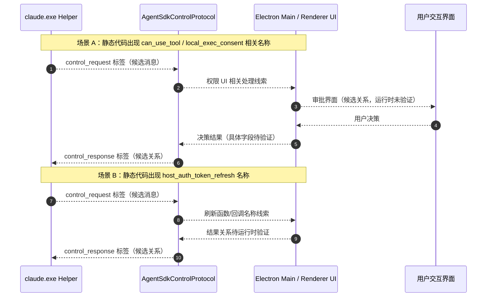
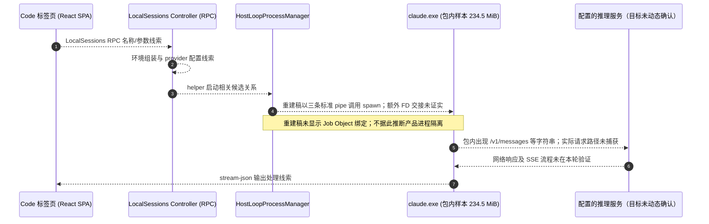

# Claude Desktop Windows MSIX — 逆向分析与架构深度解析
# Claude Desktop Windows MSIX — Deep Reverse Engineering & Architecture Analysis

[](https://github.com/tyloryang/claude-code-desktop-reverse-analyse)
[](https://github.com/tyloryang/claude-code-desktop-reverse-analyse)
[](https://github.com/tyloryang/claude-code-desktop-reverse-analyse)
[](https://github.com/tyloryang/claude-code-desktop-reverse-analyse)

---

## 📑 语言导航 / Language Navigation
- [🇨🇳 简体中文版说明](#-简体中文)
- [🇬🇧 English Documentation](#-english)

---

# 🇨🇳 简体中文

## 1. 项目简介与背景

本仓库记录使用 REA 对两个指定 Windows MSIX 样本进行的静态分析：历史样本 `2.37337.1.0` 与本目录当前样本 `2.42304.0.0`。版本号描述分析对象，不表示它是 Anthropic 当前最新发布。

分析记录覆盖 `app.asar`、打包的 Web 资源（`resources/ion-dist/`，JavaScript 总量约 116 MB）和原生扩展包元数据。当前 MSIX 中的 Code helper `claude.exe` 为 245,756,240 字节（约 234.5 MiB）；REA 对它只完成通用 PE 文件清点，本仓库没有 helper 可执行文件的语义/原生代码分析。helper 相关行为线索来自 `app.asar` 代码和包内元数据。文档区分直接观察、静态推断与未知项；静态字符串、重建代码和包内资源都不能单独证明运行时调用、完整安全属性或内网可用性。

---

## 2. 核心架构拓扑图

```
┌─────────────────────────────────────────────────────────────────────────┐
│                   Claude Desktop (Windows MSIX)                         │
├─────────────────────────────────────────────────────────────────────────┤
│                                                                         │
│  [Layer 1: 前端双容器渲染层]                                            │
│  ├─ 桌面原生外壳: .vite/renderer/main_window/ (原生标题栏、骨架屏)      │
│  └─ Web 资源: resources/ion-dist/；包内可见 app://localhost 相关线索   │
│      · bundle/CSS 含 React、Zustand、Query、TipTap 等依赖标记           │
│      · CSS 含 Monaco 样式；另有 Shiki/TextMate worker 资源              │
│      · CSS 中检出 1,070 个不同 --cds-* 名称（定义与引用的词法计数）     │
│                                                                         │
│  [Layer 2: Electron 主调度进程 (Node.js)]                               │
│  ├─ 引导入口: index.pre.js -> index.js -> index.chunk-lzaSYO3Q.js (7MB) │
│  ├─ IPC/RPC 注册表 (LocalSessions, ClaudeCode, ClaudeVM 等；静态盘点)  │
│  ├─ MCP 注册名称见包内静态清单；目录完整度与实际启用未验证           │
│  ├─ 托管配置管理: Windows 注册表 GPO (HKLM\SOFTWARE\Policies\Claude)     │
│  └─ 可见敏感文件规则、凭据 API 名称；覆盖和运行效果未验证               │
│                                                                         │
│  [Layer 3: 原生扩展包线索 (@ant/claude-native)]                          │
│  ├─ 可见 Computer Use API 名称；具体系统操作未由本静态分析验证         │
│  ├─ 原生扩展: 包内可见若干系统 API 名称；5 处完整性矛盾需谨慎解释       │
│  └─ 原生功能是否可用、是否被调用及其安全效果均未由本静态分析验证       │
│                                                                         │
│  [Layer 4: 智能体执行引擎 (claude.exe Helper)]                           │
│  ├─ 包内 claude.exe: 245,756,240 bytes; REA 仅做通用 PE 清点         │
│  ├─ stream-json 标签: 静态观察到审批/凭据刷新等协议名称                 │
│  └─ HostLoop 生命周期为重建草图；FD 传递与进程隔离未获证实              │
│                                                                         │
│  [Layer 5: Cowork 虚拟化沙箱 (Cowork VM)]                               │
│  ├─ 包内存在 HCS/VM 相关代码与资源线索；执行路径未动态验证              │
│  └─ 代理与凭据过滤线索不构成无外泄或网络隔离保证                        │
└─────────────────────────────────────────────────────────────────────────┘
```

---

## 3. 已逆向并重构的核心源码模块 (`deobfuscated/`)

本仓库的 `deobfuscated/` 中有 13 个依据静态线索编写的分析重建稿，不是厂商原始源码或可直接使用的实现；其中类型、控制流、API 完整度和行为尚未通过编译、单元测试或运行时验证。详见 [重建稿说明](deobfuscated/README.md)。

| 模块文件 | 源码逆向来源 | 核心职责与关键技术点 |
|---|---|---|
| **[DlpSecurityFilter.ts](deobfuscated/DlpSecurityFilter.ts)** | `CHpJbW9_.js` (`FFn`, `PFn`, `AFn`) | **敏感路径规则重建稿**：列出 bundle 中观察到的文件名/路径处理线索；不是已验证的 DLP 覆盖或拦截保证 |
| **[ThirdPartyMockRouter.ts](deobfuscated/ThirdPartyMockRouter.ts)** | `CHpJbW9_.js` (`Z$r`, `X$r`, `U$r`) | **3P 路由重建稿**：对应部分本地协议/API stub 线索；不证明进程全部流量被拦截或公网出网受阻 |
| **[SessionEnvironmentBuilder.ts](deobfuscated/SessionEnvironmentBuilder.ts)** | `CHpJbW9_.js` (`bJ`, `anthropicWire`) | **环境组装重建稿**：呈现 `ANTHROPIC_BASE_URL`、凭据和平台标记相关分支；完整调用链及生效条件未验证 |
| **[AgentSdkControlProtocol.ts](deobfuscated/AgentSdkControlProtocol.ts)** | `C4qJSrNf.js` & `CHpJbW9_.js` | **控制协议重建稿**：汇总静态观察到的 stream-json 标签；不代表所有标签都有完整处理器或已验证无中断刷新 |
| **[ShellPtyManager.ts](deobfuscated/ShellPtyManager.ts)** | `DIEpbncU.js` & `ptyHostWorker.js` | **PTY 管理重建稿**：整理 node-pty、watchdog 与 SSH 相关线索；重建稿未作为产品行为验证 |
| **[CodeHelperDownloader.ts](deobfuscated/CodeHelperDownloader.ts)** | `CHpJbW9_.js` (`installDirFor`, buildPin) | **helper 管理重建稿**：整理版本清单、哈希与 `CLAUDE_CODE_LOCAL_BINARY` 相关分支；不代表离线部署接口承诺 |
| **[ManagedConfigResolver.ts](deobfuscated/ManagedConfigResolver.ts)** | `CHpJbW9_.js` (`SPn`, `QUr`) | **托管配置重建稿**：涉及 `HKLM\SOFTWARE\Policies\Claude` 与 SDK 设置优先级；完整策略来源和覆盖规则待验证 |
| **[CoworkVmManager.ts](deobfuscated/CoworkVmManager.ts)** | `CHpJbW9_.js` (`startVM`, `applyVmImageDelta`) | **Cowork/VM 线索草图**：整理 HCS、虚拟化、镜像更新和代理相关标记；不证明 VM 启动或凭据隔离效果 |
| **[ClaudeNativeBindings.ts](deobfuscated/ClaudeNativeBindings.ts)** | `@ant/claude-native/*.node` package metadata | **原生 API 名称草图**：对应扩展包中观察到的名称；样本存在完整性矛盾，不能据此保证功能或安全效果 |
| **[BuiltinMcpServers.ts](deobfuscated/BuiltinMcpServers.ts)** | 内置 MCP 注册表线索 | **部分 MCP schema 草图**：当前文件只有 7 个条目，且 dispatcher 不调用实际 handler；不是完整的 12 服务目录 |
| **[LocalSessionsController.ts](deobfuscated/LocalSessionsController.ts)** | `CHpJbW9_.js` (`LocalSessions` RPC) | **会话控制重建稿**：归纳 RPC 名称与局部操作分支；交互能力与完整状态机未运行验证 |
| **[HostLoopProcessManager.ts](deobfuscated/HostLoopProcessManager.ts)** | `YBFVQBQ_.js` (`HostLoop`) | **进程生命周期草图**：当前稿未把凭据 FD 加入子进程 stdio，回退路径将 token 放入环境变量；没有 Job Object 绑定，仅有 taskkill 路径 |
| **[SurfaceReachabilityMatrix.ts](deobfuscated/SurfaceReachabilityMatrix.ts)** | `CHpJbW9_.js` (`vze`, `bze`) | **表面执行决议矩阵草图**：汇总静态识别的运行目标与策略分支；未验证目标环境中的完整策略效果 |

---

## 4. 核心系统交互时序图

### 时序图 1：Stream-JSON 控制协议候选关系
> 依据静态名称和局部代码整理的关系草图，不是已捕获的运行时完整流程；消息字段与回调顺序待验证。


### 时序图 2：Code helper 生命周期草图（交接细节未证实）


---

## 5. 前端架构与 Claude Design System (CDS)

> 详细专题分析报告：请参阅 **[docs/cds-design-tokens-and-frontend-deepdive.md](docs/cds-design-tokens-and-frontend-deepdive.md)**

1. **双容器前端渲染拓扑**：
   - 桌面外壳（`.vite/renderer/main_window/`）：HTML/脚本中可见标题栏、窗口拖拽区与 `paintShapes` 占位绘制代码；未测量其启动时序。
   - 核心 Web 应用（`resources/ion-dist/`）：纯 React SPA（约 116MB JS 资源），由 `app://localhost` 加载。
2. **CSS 中 1,070 个不同 `--cds-*` 名称**：
   - 这是变量定义与引用的去重词法计数；不能直接称为 1,070 个已生效或已定义的设计令牌。
   - 样式中观察到 `font-variation-settings` 与 `GRAD` 相关变量；其视觉效果、字宽不变和是否避免布局变化需通过目标浏览器实测，不能由 CSS 字符串单独证明。
   - 对当前样本的 25 个 CSS 文件做词法计数：`@container` 匹配 318 次、`color-mix(` 匹配 884 次、`text-box:` 声明 1 次。计数不代表唯一规则、页面覆盖或运行时效果。
3. **多线程并发 Web Worker 流水线**：
   - `highlightWorker`（约 1.5 MB）：bundle 含 Shiki、TextMate 等语法高亮相关代码；调用覆盖范围未完整追踪。
   - `framebufferCanvasWorker`（约 2KB）：静态代码可见帧解码、绘制到 `OffscreenCanvas` 和丢弃旧序号帧；没有证据证明硬件解码、GPU 直通或零拷贝。
   - `completionGzipWorker`（591B）：基于 `CompressionStream("gzip")` 实现数据流高效内存压缩。

---

## 6. 核心逆向技术文档导航

- 📘 **[claude-desktop-architecture.md](claude-desktop-architecture.md)**：全景系统架构、底层进程模型、Mermaid 交互时序图与安全边界解析主文档。
- 🎨 **[docs/cds-design-tokens-and-frontend-deepdive.md](docs/cds-design-tokens-and-frontend-deepdive.md)**：CSS 自定义属性词法计数、主题/字体轴线索、HTML 缓存预热与 Worker 资源的静态证据边界。
- 🔬 **[rea-architecture-frontend-deep-dive.md](rea-architecture-frontend-deep-dive.md)**：版本演进对比、3,644 个解包前端资源盘点及 REA 静态证据审计。

---

# 🇬🇧 English

## 1. Project Overview & Scope

This repository records REA-based static analysis of two specified Claude Desktop for Windows MSIX samples: historical version `2.37337.1.0` and the `2.42304.0.0` sample in this repository. The version identifies the analyzed artifact and is not a claim about the current release.

The notes cover `app.asar`, bundled Web assets (`resources/ion-dist/`, about 116 MB of JavaScript), and native extension package metadata. The current MSIX's Code helper `claude.exe` is 245,756,240 bytes (about 234.5 MiB); REA performed only provider-neutral PE inventory, and this repository does not contain semantic/native code analysis of that executable. Helper behavior clues are drawn from `app.asar` code and package metadata. Static strings and analyst reconstructions do not prove runtime reachability, complete security behavior, or intranet readiness.

---

## 2. Multi-Tier Architecture Topology

```
┌─────────────────────────────────────────────────────────────────────────┐
│                   Claude Desktop (Windows MSIX)                         │
├─────────────────────────────────────────────────────────────────────────┤
│                                                                         │
│  [Layer 1: Dual-Container Frontend Presentation Layer]                  │
│  ├─ Native Desktop Shell: .vite/renderer/main_window/ (Titlebar/Skeleton)│
│  └─ Web assets: resources/ion-dist/; app://localhost strings observed   │
│      · Bundles contain React, Zustand, Query, TipTap dependency markers │
│      · CSS contains Monaco styles; Shiki/TextMate worker asset observed │
│      · 1,070 distinct --cds-* names in CSS (lexical count)               │
│                                                                         │
│  [Layer 2: Electron Main Orchestration Process (Node.js)]               │
│  ├─ Core Bundle: index.pre.js -> index.js -> index.chunk-lzaSYO3Q.js   │
│  ├─ IPC/RPC registrations (LocalSessions, ClaudeCode, ClaudeVM; static)│
│  ├─ Built-in MCP registry names (static inventory; incomplete coverage)│
│  ├─ Managed Configuration: Windows Registry GPO Policy Resolution      │
│  └─ Sensitive-path / credential API clues; enforcement not validated   │
│                                                                         │
│  [Layer 3: Native Addon package clues (@ant/claude-native)]             │
│  ├─ Computer-use API names are visible; runtime operation is unverified │
│  ├─ Native API names are visible; five package-integrity conflicts need care│
│  └─ Runtime availability and security effects were not validated        │
│                                                                         │
│  [Layer 4: Agent Execution Engine (claude.exe Helper)]                  │
│  ├─ claude.exe: 245,756,240 bytes; generic inventory only              │
│  ├─ stream-json labels: approval/credential-refresh names observed      │
│  └─ HostLoop is a reconstruction; FD transfer and containment unproven  │
│                                                                         │
│  [Layer 5: Cowork Virtualization Sandbox (Cowork VM)]                   │
│  ├─ HCS/VM code and resource references are present in the package      │
│  └─ VM execution and network credential boundaries were not tested      │
└─────────────────────────────────────────────────────────────────────────┘
```

---

## 3. Deobfuscated Core TypeScript Modules (`deobfuscated/`)

The 13 TypeScript files in [`deobfuscated/`](deobfuscated/) are analyst-written reconstructions based on static clues, not vendor source or drop-in implementations. Types, control flow, API completeness, and behavior have not been verified by compilation, unit tests, or runtime execution. See [the reconstruction notes](deobfuscated/README.md).

1. **[DlpSecurityFilter.ts](deobfuscated/DlpSecurityFilter.ts)**: Reconstruction of sensitive path/name matching clues (`.pem`, `.key`, `cookies.sqlite`, `.aws/credentials`, `.env`, ADS-related checks); coverage and runtime enforcement are unverified.
2. **[ThirdPartyMockRouter.ts](deobfuscated/ThirdPartyMockRouter.ts)**: Reconstruction of selected local `app://localhost` route and API-stub clues. It does not establish that all process traffic is intercepted or public egress is blocked.
3. **[SessionEnvironmentBuilder.ts](deobfuscated/SessionEnvironmentBuilder.ts)**: Reconstruction of environment assembly branches involving `ANTHROPIC_BASE_URL`, credentials, and platform markers; effective values and call conditions are unverified.
4. **[AgentSdkControlProtocol.ts](deobfuscated/AgentSdkControlProtocol.ts)**: Reconstruction of selected stream-json labels and approval/token-refresh clues; not a complete subtype list or a guarantee of uninterrupted renewal.
5. **[ShellPtyManager.ts](deobfuscated/ShellPtyManager.ts)**: Reconstruction of node-pty, watchdog, and SSH-related code clues; runtime lifecycle was not validated.
6. **[CodeHelperDownloader.ts](deobfuscated/CodeHelperDownloader.ts)**: Reconstruction of helper manifest/hash and `CLAUDE_CODE_LOCAL_BINARY` branches; this is not a supported offline deployment interface.
7. **[ManagedConfigResolver.ts](deobfuscated/ManagedConfigResolver.ts)**: Reconstruction involving `HKLM\SOFTWARE\Policies\Claude` and SDK setting precedence; full policy source and override behavior remain unverified.
8. **[CoworkVmManager.ts](deobfuscated/CoworkVmManager.ts)**: Sketch of HCS, VM, image-update, and proxy clues; it does not prove VM startup or credential isolation.
9. **[ClaudeNativeBindings.ts](deobfuscated/ClaudeNativeBindings.ts)**: An API-name sketch for the `@ant/claude-native` package. Integrity conflicts in the analyzed sample prevent treating the listed interfaces as verified behavior.
10. **[BuiltinMcpServers.ts](deobfuscated/BuiltinMcpServers.ts)**: Partial schema sketch: the file defines seven entries, and its dispatcher does not invoke real handlers. It is not a complete 12-server catalog.
11. **[LocalSessionsController.ts](deobfuscated/LocalSessionsController.ts)**: Reconstruction of LocalSessions RPC names and selected branches; the full UI state machine and listed interactions were not runtime-verified.
12. **[HostLoopProcessManager.ts](deobfuscated/HostLoopProcessManager.ts)**: Incomplete lifecycle sketch. It sets an FD number in the environment but spawns with only three standard pipes, so the child FD handoff is not established; the fallback places the token in an environment variable, and this sketch has no Job Object binding.
13. **[SurfaceReachabilityMatrix.ts](deobfuscated/SurfaceReachabilityMatrix.ts)**: Global execution target matrix (`vze`) and policy constraints (`bze`) across Chat, Code, Cowork, and Routines.

These files describe the analysts' models, not guaranteed Claude Desktop behavior. Do not use the HostLoop credential/process sketch or MCP dispatcher as a production implementation or security control.

---

## 4. Key Architectural Documents

+ 📘 **[claude-desktop-architecture.md](claude-desktop-architecture.md)**: Historical `2.37337.1.0` architecture notes with static evidence and coverage limitations.
+ 🎨 **[docs/cds-design-tokens-and-frontend-deepdive.md](docs/cds-design-tokens-and-frontend-deepdive.md)**: Current sample CSS token inventory, lexical counts, and frontend evidence boundaries.
+ 🔬 **[rea-architecture-frontend-deep-dive.md](rea-architecture-frontend-deep-dive.md)**: Analysis of the repository's `2.42304.0.0` sample, including selected frontend bundles and explicit coverage limits.

---

## 🛠️ Repository Quick Start

```bash
# Clone the repository
git clone https://github.com/tyloryang/claude-code-desktop-reverse-analyse.git
cd claude-code-desktop-reverse-analyse

# Inspect the deobfuscated TypeScript modules
ls -la deobfuscated/

# View detailed architecture diagrams and write-up
cat claude-desktop-architecture.md
```

---

## ⚖️ Disclaimer
This project is an independent static-analysis research note. It is not an official product description, runtime validation, complete reverse engineering, a security assessment, or confirmation of intranet/offline readiness. Reconstructions are analyst-written reading aids. All trademarks and registered names belong to Anthropic, PBC.
