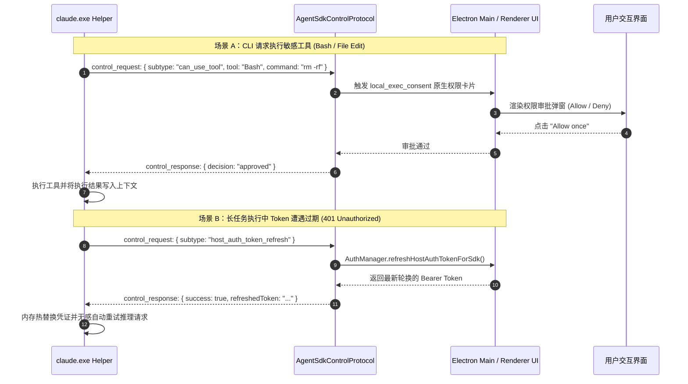
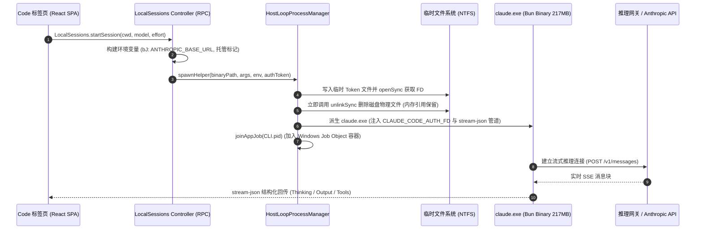

# Claude Desktop Windows MSIX — 逆向分析与架构深度解析
# Claude Desktop Windows MSIX — Deep Reverse Engineering & Architecture Analysis

[](https://github.com/tyloryang/claude-code-desktop-reverse-analyse)
[](https://github.com/tyloryang/claude-code-desktop-reverse-analyse)
[](https://github.com/tyloryang/claude-code-desktop-reverse-analyse)
[](https://github.com/tyloryang/claude-code-desktop-reverse-analyse)

---

## 📑 语言导航 / Language Navigation
- [🇨🇳 简体中文版说明](#-简体中文)
- [🇬🇧 English Documentation](#-english)

---

# 🇨🇳 简体中文

## 1. 项目简介与背景

本项目对 Anthropic 官方发布的 **Claude Desktop for Windows (MSIX 打包版)** 展开了深度的静态代码逆向分析（基于 REA 静态证据库）。分析涵盖了历史版本 `2.37337.1.0` 与当前最新版本 `2.42304.0.0`。

通过对 `app.asar`、解包 Web 资产（`resources/ion-dist/` 116MB 前端）、Rust 原生绑定（`@ant/claude-native`）以及打包的 217MB 独立 CLI 二进制（`claude.exe`）进行静态反编译与反混淆，我们完整揭示了 Claude Desktop 的系统分层架构、双向控制协议、数据防泄漏 (DLP) 机制、容器虚拟机沙箱以及工业级设计系统 (CDS)。

---

## 2. 核心架构拓扑图

```
┌─────────────────────────────────────────────────────────────────────────┐
│                   Claude Desktop (Windows MSIX)                         │
├─────────────────────────────────────────────────────────────────────────┤
│                                                                         │
│  [Layer 1: 前端双容器渲染层]                                            │
│  ├─ 桌面原生外壳: .vite/renderer/main_window/ (原生标题栏、骨架屏)      │
│  └─ 核心 Web SPA: resources/ion-dist/ -> app://localhost (离线 3P 模式)  │
│      · 状态层: Zustand (客户端原子 Store) + TanStack Query (服务端缓存) │
│      · 编辑器: ProseMirror + TipTap (胶囊节点、斜杠指令、富文本提示词)  │
│      · 代码/Diff: Monaco Editor + Shiki 离线语法高亮 Web Worker         │
│      · 设计体系: Claude Design System (1,070 个 --cds-* 令牌 + GRADE)   │
│                                                                         │
│  [Layer 2: Electron 主调度进程 (Node.js)]                               │
│  ├─ 引导入口: index.pre.js -> index.js -> index.chunk-lzaSYO3Q.js (7MB) │
│  ├─ 59 个类型化 RPC 命名空间 (LocalSessions, ClaudeCode, ClaudeVM 等)    │
│  ├─ 12 个内置 MCP 服务器 (ccd_view, ccd_window, ccd_host, terminal 等)   │
│  ├─ 托管配置管理: Windows 注册表 GPO (HKLM\SOFTWARE\Policies\Claude)     │
│  └─ 敏感文件 DLP 拦截与 DPAPI 双层本地加密安全存储                      │
│                                                                         │
│  [Layer 3: Rust 原生系统扩展 (@ant/claude-native)]                      │
│  ├─ Computer Use 自动化: 屏幕捕获、无级鼠标移动、键盘字符注入           │
│  ├─ 路径逃逸防御 (*Beneath): 内核级句柄隔离，严防 ../../ 越权跳跃       │
│  ├─ 凭证与硬件证明: Windows DPAPI、Windows Hello 生物识别、TPM 硬件签名 │
│  └─ 进程生命周期隔离: Windows Job Object 强绑定                         │
│                                                                         │
│  [Layer 4: 智能体执行引擎 (claude.exe Helper)]                           │
│  ├─ 打包机制: 基于 Bun Compile 打包的单一 217MB 原生 PE 二进制           │
│  ├─ 控制管道: 双向 stream-json 协议 (59 种子类型: can_use_tool 等)      │
│  └─ 生命周期管理: HostLoop 调度，凭据 FD 匿名化隔离，taskkill 级联终止   │
│                                                                         │
│  [Layer 5: Cowork 虚拟化沙箱 (Cowork VM)]                               │
│  ├─ 虚拟化底层: Windows Host Compute System (HCS) / Hyper-V             │
│  ├─ 容器内核: gVisor 独立轻量微虚拟机                                   │
│  └─ 凭证边界: 本地 MITM 代理白名单过滤 (NSn)，杜绝敏感 Token 外泄       │
└─────────────────────────────────────────────────────────────────────────┘
```

---

## 3. 已逆向并重构的核心源码模块 (`deobfuscated/`)

本项目已将主进程和 SDK 中高度混淆的核心逻辑反混淆、补充完整强类型定义与业务注释，并在 [`deobfuscated/`](deobfuscated/) 目录提供了可独立阅读与测试的 13 个 TypeScript 源码模块：

| 模块文件 | 源码逆向来源 | 核心职责与关键技术点 |
|---|---|---|
| **[DlpSecurityFilter.ts](deobfuscated/DlpSecurityFilter.ts)** | `CHpJbW9_.js` (`FFn`, `PFn`, `AFn`) | **数据防泄漏 (DLP)**：敏感私钥/证书 (`.pem`, `.key`, `id_rsa`)、浏览器 Cookie、云凭证拦截；防御 NTFS 备用数据流 (ADS) 遍历攻击 |
| **[ThirdPartyMockRouter.ts](deobfuscated/ThirdPartyMockRouter.ts)** | `CHpJbW9_.js` (`Z$r`, `X$r`, `U$r`) | **纯内网 3P 路由**：拦截并注册 `app://localhost` 协议，提供 `/api/bootstrap`、`/i18n` 等本地 Mock 接口，阻断公网出网 |
| **[SessionEnvironmentBuilder.ts](deobfuscated/SessionEnvironmentBuilder.ts)** | `CHpJbW9_.js` (`bJ`, `anthropicWire`) | **环境变量组装**：构造 `ANTHROPIC_BASE_URL`，清除明文凭证，挂载平台标识头及自建网关路由配置 |
| **[AgentSdkControlProtocol.ts](deobfuscated/AgentSdkControlProtocol.ts)** | `C4qJSrNf.js` & `CHpJbW9_.js` | **双向控制协议**：59 种子类型 `stream-json` 消息分发；实现 `can_use_tool` 原生卡片审批与 `host_auth_token_refresh` 动态 Token 刷新 |
| **[ShellPtyManager.ts](deobfuscated/ShellPtyManager.ts)** | `DIEpbncU.js` & `ptyHostWorker.js` | **终端 PTY 管理**：管理 `utilityProcess` 中的 node-pty 进程，30 秒心跳 Watchdog 自动 refork，SSH 代理链集成 |
| **[CodeHelperDownloader.ts](deobfuscated/CodeHelperDownloader.ts)** | `CHpJbW9_.js` (`installDirFor`, buildPin) | **CLI 版本管理**：解析远端 BuildPin 清单，校验 SHA-256 哈希，基于哈希切片组织目录，支持 `CLAUDE_CODE_LOCAL_BINARY` 覆盖 |
| **[ManagedConfigResolver.ts](deobfuscated/ManagedConfigResolver.ts)** | `CHpJbW9_.js` (`SPn`, `QUr`) | **企业注册表策略**：解析 `HKLM\SOFTWARE\Policies\Claude` GPO，严格映射 SDK 四级配置（`user < project < projectLocal < managed`） |
| **[CoworkVmManager.ts](deobfuscated/CoworkVmManager.ts)** | `CHpJbW9_.js` (`startVM`, `applyVmImageDelta`) | **Cowork 虚拟机底座**：调用 Windows HCS 接口管理 gVisor 虚拟机，实现 VM 差量增量热升级与 MITM 白名单凭证审批 |
| **[ClaudeNativeBindings.ts](deobfuscated/ClaudeNativeBindings.ts)** | `@ant/claude-native/*.node` (NAPI-RS) | **Win32 底层系统绑定**：Computer Use 自动化、内核级 `*Beneath` 路径防御、DPAPI、Windows Hello、TPM 硬件证明与 Job Object 容器 |
| **[BuiltinMcpServers.ts](deobfuscated/BuiltinMcpServers.ts)** | 内置 MCP 注册表 (`go(uv,...)`) | **12 大内置 MCP 服务器**：集中式协议定义与调度器（`ccd_view`, `ccd_window`, `ccd_session_mgmt`, `terminal`, `ccd_host` 等） |
| **[LocalSessionsController.ts](deobfuscated/LocalSessionsController.ts)** | `CHpJbW9_.js` (`LocalSessions` RPC) | **会话状态机调度**：UI 交互操作面，支持多模态消息发送、Fork 分叉会话、脱离父级、模型与 Effort 实时切换 |
| **[HostLoopProcessManager.ts](deobfuscated/HostLoopProcessManager.ts)** | `YBFVQBQ_.js` (`HostLoop`) | **进程组生命周期**：派生 `claude.exe`，敏感 Token 匿名 FD 写入并立即物理 unlink，Windows Job Object 与 `taskkill /T /F` 强制树状级联回收 |
| **[SurfaceReachabilityMatrix.ts](deobfuscated/SurfaceReachabilityMatrix.ts)** | `CHpJbW9_.js` (`vze`, `bze`) | **表面执行决议矩阵**：跨 Chat / Code / Cowork 决议运行目标（device 宿主、sshHost 远程、cloud 云端），实施安全策略阻断 |

---

## 4. 核心系统交互时序图

### 时序图 1：双向 Stream-JSON 控制流（权限审批与 Token 动态刷新）


### 时序图 2：Code 标签页会话派生与凭证隔离


---

## 5. 前端架构与 Claude Design System (CDS)

1. **双容器前端渲染拓扑**：
   - 桌面外壳（`.vite/renderer/main_window/`）：负责原生标题栏、窗口拖拽区（`-webkit-app-region: drag`）与微秒级行内骨架屏占位（`paintShapes`）。
   - 核心 Web 应用（`resources/ion-dist/`）：纯 React SPA（约 116MB JS 资源），由 `app://localhost` 加载。
2. **1,070 个 `--cds-*` 语义设计令牌**：
   - 全量采用语义命名空间（`font`, `surface`, `fill`, `text`, `alpha`, `pad`, `gap` 等）。
   - **GRADE 字体光学补偿机制**：在 Windows 暗色模式下，借助可变字体的 `"GRAD"`（级差）轴调小笔画，完美消除人眼光晕膨胀（Halation Effect），同时保持字符水平物理度量绝对 0 偏差，彻底根除切主题时的文本排版跳动。
3. **多线程并发 Web Worker 流水线**：
   - `highlightWorker`（1.5MB）：基于 Shiki 的 TextMate 离线语法高亮。
   - `framebufferCanvasWorker`：通过 `OffscreenCanvas` 与 `ImageDecoder` 硬件解码，直通 GPU 渲染 Computer Use 屏幕画面，自动丢弃陈旧滞后帧。

---

# 🇬🇧 English

## 1. Project Overview & Scope

This repository provides an exhaustive, production-grade reverse engineering and architectural analysis of **Claude Desktop for Windows (MSIX Package)** based on static REA (Reverse Engineering Artifact) evidence. It comprehensively covers both baseline version `2.37337.1.0` and the latest release `2.42304.0.0`.

By deconstructing the Electron application package (`app.asar`), bundled Web assets (`resources/ion-dist/` comprising 116MB of JavaScript), native Rust extensions (`@ant/claude-native`), and the standalone 217MB CLI engine (`claude.exe`), this project uncovers the internal multi-process topology, bidirectional stream-json protocol, Data Loss Prevention (DLP) filters, virtualization sandboxes, and the enterprise design system.

---

## 2. Multi-Tier Architecture Topology

```
┌─────────────────────────────────────────────────────────────────────────┐
│                   Claude Desktop (Windows MSIX)                         │
├─────────────────────────────────────────────────────────────────────────┤
│                                                                         │
│  [Layer 1: Dual-Container Frontend Presentation Layer]                  │
│  ├─ Native Desktop Shell: .vite/renderer/main_window/ (Titlebar/Skeleton)│
│  └─ Core Web Application: resources/ion-dist/ -> app://localhost       │
│      · State: Zustand (Atomic Stores) + TanStack Query (Server Cache)   │
│      · Composer: ProseMirror + TipTap (Pill Nodes, Slash Commands)      │
│      · Code/Diff: Monaco Editor + Shiki Offline Syntax Highlighting     │
│      · Design System: Claude Design System (1,070 --cds-* tokens)       │
│                                                                         │
│  [Layer 2: Electron Main Orchestration Process (Node.js)]               │
│  ├─ Core Bundle: index.pre.js -> index.js -> index.chunk-lzaSYO3Q.js   │
│  ├─ 59 Typed RPC Namespaces (LocalSessions, ClaudeCode, ClaudeVM, etc.) │
│  ├─ 12 Built-in MCP Servers (ccd_view, ccd_window, ccd_host, terminal)  │
│  ├─ Managed Configuration: Windows Registry GPO Policy Resolution      │
│  └─ DLP Sensitive File Blacklists & Dual-Layer DPAPI Local Encryption   │
│                                                                         │
│  [Layer 3: Rust Native System Addon (@ant/claude-native)]               │
│  ├─ Computer Use Automation: Display capture, mouse/keyboard injection  │
│  ├─ Kernel Traversal Defense (*Beneath): Handle-level root sandboxing    │
│  ├─ System Security: Windows DPAPI, Windows Hello Biometrics, TPM Key   │
│  └─ Process Isolation: Windows Job Object Containment                   │
│                                                                         │
│  [Layer 4: Agent Execution Engine (claude.exe Helper)]                  │
│  ├─ Binary Packaging: 217MB PE binary bundled with Bun Compile         │
│  ├─ Control Channel: Bidirectional stream-json (59 control sub-types)   │
│  └─ Process Lifecycle: HostLoop management, anonymous FD credential     │
│     staging with immediate physical unlink, taskkill tree-kill cleanup  │
│                                                                         │
│  [Layer 5: Cowork Virtualization Sandbox (Cowork VM)]                   │
│  ├─ Virtualization Backend: Windows Host Compute System (HCS) / Hyper-V │
│  ├─ Container Kernel: gVisor lightweight microVM                       │
│  └─ Network Security: Local MITM proxy credential whitelisting (NSn)    │
└─────────────────────────────────────────────────────────────────────────┘
```

---

## 3. Deobfuscated Core TypeScript Modules (`deobfuscated/`)

The repository includes clean, structured, and strongly-typed TypeScript implementations of the key internal subsystems located in [`deobfuscated/`](deobfuscated/):

1. **[DlpSecurityFilter.ts](deobfuscated/DlpSecurityFilter.ts)**: Data Loss Prevention filter. Blocks sensitive keys (`.pem`, `.key`, `id_rsa`), browser credentials (`cookies.sqlite`), cloud tokens (`.aws/credentials`, `.env`), and blocks NTFS Alternate Data Stream (ADS) traversal attacks.
2. **[ThirdPartyMockRouter.ts](deobfuscated/ThirdPartyMockRouter.ts)**: Local protocol router for `app://localhost`. Intercepts offline requests (`/api/bootstrap`, `/i18n/*`, plugin listings) to run entirely offline without external egress.
3. **[SessionEnvironmentBuilder.ts](deobfuscated/SessionEnvironmentBuilder.ts)**: Code helper CLI environment builder (`bJ()`). Handles `ANTHROPIC_BASE_URL` gateway overrides, credential stripping, and platform header injection.
4. **[AgentSdkControlProtocol.ts](deobfuscated/AgentSdkControlProtocol.ts)**: Implements the 59 stream-json control subtypes, including `can_use_tool` user consent card approval and `host_auth_token_refresh` zero-interruption token renewal.
5. **[ShellPtyManager.ts](deobfuscated/ShellPtyManager.ts)**: Terminal PTY manager for `utilityProcess.fork(ptyHostWorker.js)` with a 30-second watchdog auto-refork mechanism and SSH broker integration.
6. **[CodeHelperDownloader.ts](deobfuscated/CodeHelperDownloader.ts)**: Code helper version manager and BuildPin validator. Resolves `downloads.claude.ai` manifests, verifies SHA-256 hashes, and supports `CLAUDE_CODE_LOCAL_BINARY` overrides.
7. **[ManagedConfigResolver.ts](deobfuscated/ManagedConfigResolver.ts)**: Windows Registry GPO resolver (`HKLM\SOFTWARE\Policies\Claude`). Resolves the 4-tier SDK settings precedence (`user < project < projectLocal < managed`).
8. **[CoworkVmManager.ts](deobfuscated/CoworkVmManager.ts)**: Cowork VM sandbox controller. Interrogates Windows HCS / VirtualMachinePlatform, applies differential image patches (`applyVmImageDelta`), and enforces MITM proxy credential filtering.
9. **[ClaudeNativeBindings.ts](deobfuscated/ClaudeNativeBindings.ts)**: Type definitions for the `@ant/claude-native` NAPI-RS binary: Computer Use automation, `*Beneath` traversal defense, Windows Hello, and TPM hardware key signing.
10. **[BuiltinMcpServers.ts](deobfuscated/BuiltinMcpServers.ts)**: Complete schemas and dispatcher for the 12 built-in MCP servers (`ccd_view`, `ccd_window`, `ccd_session_mgmt`, `terminal`, `ccd_host`, etc.).
11. **[LocalSessionsController.ts](deobfuscated/LocalSessionsController.ts)**: UI-facing session state machine supporting multimodal prompt submission, session forking, model selection, and effort level adjustment.
12. **[HostLoopProcessManager.ts](deobfuscated/HostLoopProcessManager.ts)**: CLI helper lifecycle runner. Stages credentials via temporary FDs with immediate disk unlink, joins Windows Job Objects, and enforces tree-kill fallback via `taskkill /T /F`.
13. **[SurfaceReachabilityMatrix.ts](deobfuscated/SurfaceReachabilityMatrix.ts)**: Global execution target matrix (`vze`) and policy constraints (`bze`) across Chat, Code, Cowork, and Routines.

---

## 4. Key Architectural Documents

- 📘 **[claude-desktop-architecture.md](claude-desktop-architecture.md)**: The definitive, comprehensive architecture manual containing sequence diagrams, memory models, security boundaries, and full REA evidence citations.
- 🔬 **[rea-architecture-frontend-deep-dive.md](rea-architecture-frontend-deep-dive.md)**: Specialized deep dive into the latest `2.42304.0.0` frontend bundle assets, Web Worker thread separation, and CDS design tokens.

---

## 🛠️ Repository Quick Start

```bash
# Clone the repository
git clone https://github.com/tyloryang/claude-code-desktop-reverse-analyse.git
cd claude-code-desktop-reverse-analyse

# Inspect the deobfuscated TypeScript modules
ls -la deobfuscated/

# View detailed architecture diagrams and write-up
cat claude-desktop-architecture.md
```

---

## ⚖️ Disclaimer
This project is an independent technical research effort conducted strictly for security assessment, interoperability analysis, and architecture exploration. All trademarks and registered names belong to Anthropic, PBC.
