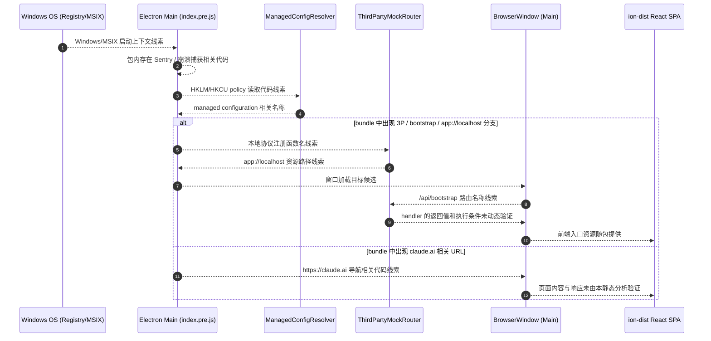
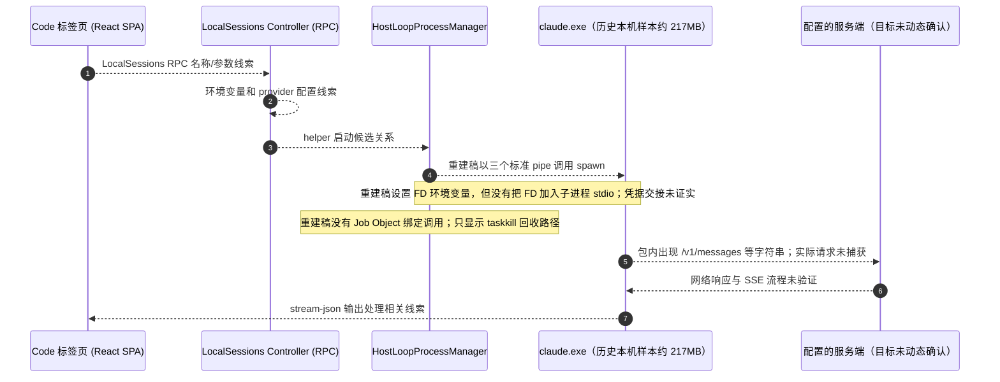
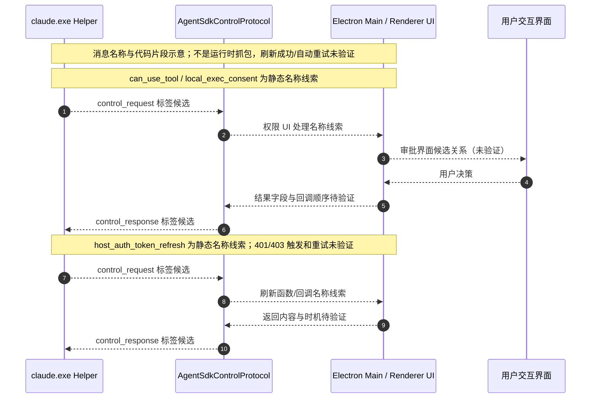
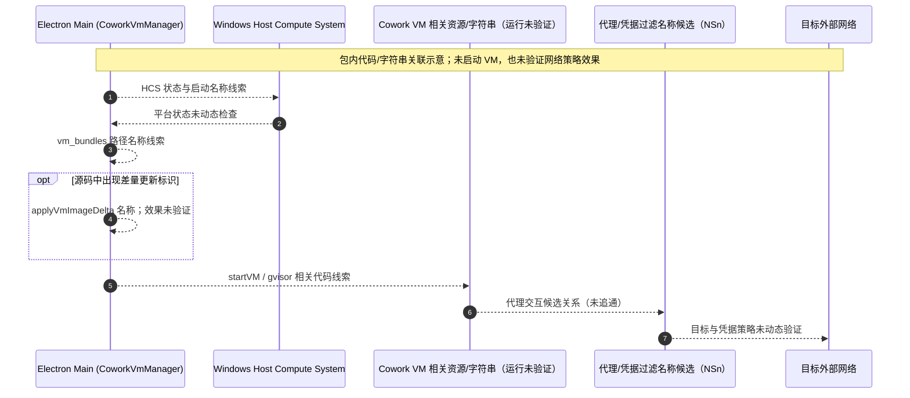
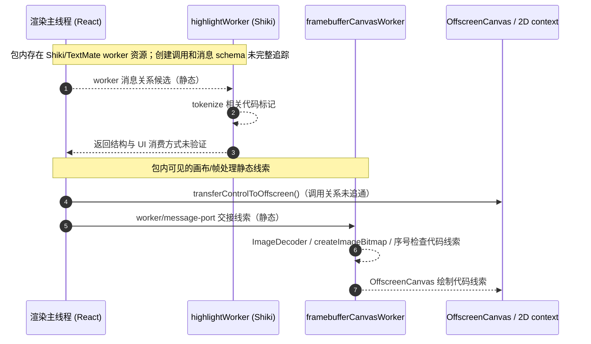

# Claude Desktop 2.37337.1 (Windows MSIX) — REA 静态分析架构图
> **版本提示（2026-10-18）：** 本稿对应 Claude Desktop 2.37337.1.0，是历史版本分析。本目录当前 `Claude.msix` 为 2.42304.0.0；新版 REA 与前端分析见 [rea-architecture-frontend-deep-dive.md](rea-architecture-frontend-deep-dive.md)。旧稿中的 bundle 名、资源数量和配置细节不应直接视作新版事实。

> 证据来源：`app.asar`（SHA-256 `6290a54e…`）静态解析 + 解包文本检索。
> 所有结论为静态观察/推断（REA Evidence `ev_b646af…`），不证明运行时行为。
> 文中部分命名、控制流和安全意图是从局部片段归纳的假设；后续 `deobfuscated/` TypeScript 文件是分析重建稿，不是厂商原始源码或经过测试的实现。

## 1. 总体架构

```
┌────────────────────────────────────────────────────────────────────┐
│  Claude Desktop  (Electron, MSIX: Claude_2.37337.1.0_x64)          │
│  package.json: @ant/desktop  main = .vite/build/index.pre.js        │
├────────────────────────────────────────────────────────────────────┤
│                                                                    │
│  Main 进程 (Node)                                                   │
│  index.pre.js ─→ index.js ─→┬─ index.chunk-CC6MOcaE.js  (引导/公共) │
│                            └─ index.chunk-CHpJbW9_.js (核心,6.7MB)│
│                                        │  require 142 个 chunk      │
│  ┌─────────────────────────────────────┴──────────────────────┐    │
│  │ 主进程子系统（本轮在 index.chunk 中检索到的静态线索）        │    │
│  │                                                            │    │
│  │  · 托管配置   registry/GPO `HKLM\SOFTWARE\Policies\Claude`  │    │
│  │                + `Policies\ClaudeCode`（Code 会话检测）     │    │
│  │  · Provider 抽象 anthropic / gateway / vertex / bedrock /   │    │
│  │                foundry（inferenceProvider 配置键）          │    │
│  │  · 模型目录   https://downloads.claude.ai/                  │    │
│  │                model-catalog/v1/catalog.json（签名,5–15min 轮询）│
│  │  · 自动更新   autoUpdater / Squirrel-MSIX updater,          │    │
│  │                存在 disableAutoUpdates 配置线索              │    │
│  │  · Code helper 下载管理 buildPin 清单(版本+校验和+大小),    │    │
│  │                baseUrl https://downloads.claude.ai/         │    │
│  │                claude-code-releases,claude-ssh-releases     │    │
│  │                CLAUDE_CODE_LOCAL_BINARY 可本地覆盖          │    │
│  │  · Cowork VM  userData/claude-code-vm (vmStorageDir)        │    │
│  │  · OAuth 登录  claude.ai / platform.claude.com /v1/oauth/*   │    │
│  │  · 遥测       Sentry + Datadog intake + 可配 OTLP 导出       │    │
│  └────────────────────────────────────────────────────────────┘    │
│                                                                    │
│  Renderer 窗口（sandbox:!0, contextIsolation:!0, nodeIntegration:0)│
│  ├─ main_window        主 UI（Chat/Cowork/Code 标签页所在）        │
│  ├─ buddy_window / quick_window / about_window                     │
│  ├─ find_in_page       查找栏（preload: .vite/build/findInPage.js）│
│  └─ local_exec_consent / computerUse* 等辅助窗口                   │
│                                                                    │
│  Utility Process 子进程                                             │
│  ├─ pty-host/ptyHostWorker.js  node-pty 终端宿主                   │
│  │    （消息端口通信; Windows 默认 powershell.exe,                  │
│  │     失败回退 conpty; SSH 会话经 ssh -t … exec $SHELL）          │
│  └─ file-index-worker/fileIndexWorker.js  文件索引                 │
│                                                                    │
│  外置辅助二进制（app\resources\，均在 ASAR 外）                    │
│  ├─ claude-ssh-broker.exe / claude-ssh-proxy.exe / askpass        │
│  ├─ github-mcp\github-mcp-server.exe（内置 MCP 服务器）            │
│  └─ office365-mcp\*.node + msalruntime.dll（M365 MCP）             │
└────────────────────────────────────────────────────────────────────┘
                          │ IPC（$eipc_message$_UUID_$_通道名, 前缀校验）
                          ▼
┌────────────────────────────────────────────────────────────────────┐
│  Code 标签页 = Claude Code CLI（独立原生 helper）                    │
│                                                                    │
│  1) 会话启动时 Desktop 在 userData 下管理 claude.exe 副本：        │
│     buildPin 版本 52d82f0a…, 平台清单(每平台 checksum+size),        │
│     win32-x64: claude.exe.zst (~91.9MB 压缩)                       │
│     下载源 https://downloads.claude.ai/claude-code-releases        │
│     bundle 中可见校验与回退相关分支；实际选择路径未验证            │
│                                                                    │
│  2) Desktop 用组装 env 启动 helper：函数 bJ() 设置                  │
│     ANTHROPIC_BASE_URL = e.apiHost ← getApiHost()                  │
│       = provider.apiHostOverride() ?? 默认 anthropic API            │
│     (gateway provider: apiHostOverride = creds.baseUrl =           │
│      inferenceGatewayBaseUrl 配置值; E2E 测试可被                   │
│      CLAUDE_E2E_INFERENCE_BASE_URL 覆盖,默认 api.anthropic.com)    │
│     另注入 ANTHROPIC_API_KEY/AUTH_TOKEN(清空后由 secrets 落盘)、    │
│     CLAUDE_CODE_OAUTH_TOKEN、CLAUDE_CODE_HOST_AUTH_ENV_VAR 等      │
│                                                                    │
│  3) bundle 中可见 writeSessionSecrets、凭据类型与 session-secrets │
│     相关名称；完整凭据交接路径与安全效果未独立验证                │
│                                                                    │
│  4) helper 包含 Code CLI 相关能力线索（覆盖范围未完整验证）:       │
│     端点 /v1/messages(含 beta)、/v1/messages/batches、              │
│     count_tokens、/v1/complete、files、models、organizations/*、    │
│     agents/sessions/skills/vaults…（名称线索，不证明完整可用）     │
│     内置 env 白名单: ANTHROPIC_BASE_URL、ANTHROPIC_API_KEY…        │
│     多 provider 变量: *_BEDROCK_/*_VERTEX_/*_FOUNDRY_BASE_URL      │
│     allowedProviders/custodians 由 managed settings 钉死          │
│                                                                    │
│  5) 标题生成等一次性调用可不经 helper: 主进程直接 POST              │
│     /v1/messages（Prn() 构造 requestUrl+headers,                   │
│     anthropic-version 2023-06-01）                                 │
└────────────────────────────────────────────────────────────────────┘
                          │
                          ▼
┌────────────────────────────────────────────────────────────────────┐
│  出网端点（仅列代码中字符串证据）                                   │
│  api.anthropic.com · platform.claude.com · claude.ai/claude.com    │
│  downloads.claude.ai (helper/SSH二进制+model-catalog+更新)         │
│  releases.claude.com (updateViaUpdatesHost 时) · sentry.io ·       │
│  *.ingest.us.sentry.io · browser-intake-*.datadoghq.com ·          │
│  storage.googleapis.com · www.google.com/*.gstatic.com (favicon)   │
│  + inferenceGatewayBaseUrl 指向的自建网关                          │
└────────────────────────────────────────────────────────────────────┘
```

## 2. 关键文件—子系统对照

| 文件（ASAR 内路径） | 角色 |
|---|---|
| `package.json` | `@ant/desktop` 2.37337.1, main 入口 |
| `.vite/build/index.pre.js` | 主进程引导（Sentry 初始化 → index.js） |
| `.vite/build/index.chunk-CHpJbW9_.js` | 核心：配置/Provider/网关/更新/helper 下载/认证（6.7MB） |
| `.vite/build/index.chunk-C4qJSrNf.js` | Claude Code CLI SDK 主体（env 变量、OAuth 常量、managed-settings 逻辑）（1.2MB） |
| `.vite/build/index.chunk-Csli2d_D.js` | Anthropic API 客户端类（/v1/* 全端点） |
| `.vite/build/index.chunk-DIEpbncU.js` | pty-host 宿主 + ShellPtyManager（终端） |
| `.vite/build/pty-host/ptyHostWorker.js` | node-pty worker（utilityProcess.fork） |
| `.vite/build/mainWindow.js` / `mainView.js` | 主窗口 preload/视图桥 |
| `.vite/build/findInPage.js` | 查找窗口 preload |
| `.vite/build/code-*/` 等其余 chunk | Code 会话、Cowork、SSH 等按需加载 |
| `node_modules/@ant/claude-native/*.node` | 桌面原生扩展（unpacked，签名校验有 6 处 contradiction 记录） |
| `resources/github-mcp/`, `resources/office365-mcp/` | 内置 MCP 服务器二进制 |

## 3. 与"离线内网部署"相关的静态结论（2.37337.1.0）

- **网关线索**：静态配置中出现 `inferenceProvider:"gateway"`、`inferenceGatewayBaseUrl`、`ANTHROPIC_BASE_URL` 和 `/v1/models`；目标部署的生效条件与完整请求链尚未动态验证。
- **非必要流量控制线索（不是出口封锁）**：
  `disableAutoUpdates`、`disableEssentialTelemetry`、`disableNonessentialTelemetry`、
  `disableNonessentialServices`、`modelCatalogEnabled:false`（或 `modelCatalogUrl` 内网镜像）。
  这些键分别关联更新、遥测或目录请求；它们不等同于阻断登录、模型请求或进程级公网出口。
- **helper 下载线索**：包内出现 `downloads.claude.ai/claude-code-releases`、buildPin 与 `CLAUDE_CODE_LOCAL_BINARY` 分支。它们不证明 Code 在断网时可启动，也不构成稳定受支持的离线安装接口。
- **托管配置**：Windows 读 `HKLM/HKCU\SOFTWARE\Policies\Claude`（Desktop 键）与
  `SOFTWARE\Policies\ClaudeCode`（Code 会话托管设置）；MDM/GPO 值类型不合法会整块忽略。

## 4. 深入分析补充（第二轮，静态证据）

### 4.1 双渲染模式：`app://localhost`（3P）vs `claude.ai`（1P）

- `iu = "app://localhost"`：custom-3p 部署下主视图的固定 origin。
- `Z$r()` 安装 `app://` protocol handler：仅接受 `hostname === "localhost"`，
  `Origin` 不等于 `app://localhost` 返回 403；文件从
  `userData/../ion-dist`（ASAR 内 `resources/ion-dist`，即"bundled local web application"）读取。
  剩余路径由 custom-3p stub 响应（失败返回 503）。
- 标准模式（1P）：`QD() = getMainWindowUrl()` → `https://claude.ai`，重定向由
  claudeURLHandler 处理（`claude://` 深链白名单协议）。
- 登录态切换：`c=LJn()`（已登录）；`u = c ? "app" : "login"`；未登录时用 `GJn(e)` 恢复登录窗口布局。
- 主窗口 preload：`.vite/build/mainWindow.js`，`additionalArguments` 携带 window token。

### 4.2 Privileged schemes（注册于 app ready 前）

`cowork-artifact://`、`cowork-file://`（stream）、`claude-media://`（bypassCSP）、
`claude-simulator://`（corsEnabled）+ 动态 `e_n`（含 `app`）。

### 4.3 IPC 桥（帧级安全）

- 通道前缀：`$eipc_message$_7e53d64a-…-…$_claude.internal.ui_$_<Window>_$_<method>`。
- 在 mainWindow preload 中静态清点到的 11 个通道名称（未做运行时调用验证）：
  `AboutWindow_$_{openHelp,getSupport,getAppName,getBuildProps,ancientJournal}`、
  `MainWindowTitleBar_$_{titleBarReady,requestRestartApp,requestReloadMainView,requestMainMenuPopup}`、
  `QuickWindow_$_{requestDismiss,requestSkooch}`。
- preload 代码中可见帧标识比较：`webFrame.top.frameToken === webFrame.frameToken`
  （fallback `routingId`）；main 侧另有 `frame-id`/`process-id`/`sender-frame` 校验线索
  （`index.chunk-CHpJbW9_.js` 的 sender-validation-candidate 观测），完整授权效果未验证。

### 4.4 custom-3p 的 Provider 工厂（配置 → creds）

`switch(t.provider)`：`anthropic` / `gateway` / `vertex` / `bedrock` / `mantle` / `foundry`。
- `gateway`: `baseUrl = t.baseUrl ?? du.gatewayBaseUrl`（默认 anthropic.com 不适用——
  构造时 `CLAUDE_E2E_INFERENCE_BASE_URL ?? "https://api.anthropic.com"`），
  凭证类型 static / interactive(=sso) / external-idp(OIDC)；
  `gatewayManagedClaudeCode`（flatKey `inferenceGatewayManagedClaudeCode`，
  2.9939.2+，public-undocumented）开启后由 Desktop 全面托管 Code 路由。
- `getApiHost() = provider.apiHostOverride() ?? bgn`；3P anthropic/gateway 的
  `apiHostOverride() = creds.baseUrl`。
- 主进程一次性探测（如标题生成）直接 `POST {baseUrl}/v1/messages`，
  headers 含 `anthropic-version: 2023-06-01`。

### 4.5 网关模型发现

`t6t()`：`GET {gateway}/v1/models?limit=1000`（分页 `after_id`，最多若干页，
失败保留已读行）。未实现时用 `inferenceModels` 静态列表（1–200 项，gatewayServable:!1）。
当 `managesProviderRouting` 时强制 `CLAUDE_CODE_MODEL_CATALOG:"0"`（禁 CLI 目录拉取）。

### 4.6 Code helper 启动环境（`bJ()` 全量 env）

```
CLAUDE_CODE_ENTRYPOINT=<surface>
ANTHROPIC_BASE_URL=<apiHost>            ← gateway 时即 inferenceGatewayBaseUrl
ANTHROPIC_API_KEY / ANTHROPIC_AUTH_TOKEN / ANTHROPIC_CUSTOM_HEADERS = ""（先清空，
                                        再由 ccd-session-secrets 物化注入）
CLAUDE_CODE_OAUTH_TOKEN / _SCOPES / _SUBSCRIPTION_TYPE / _RATE_LIMIT_TIER
CLAUDE_CODE_DESKTOP_APP_VERSION（非 3P 才带）
CLAUDE_CODE_PROVIDER_MANAGED_BY_HOST=1（托管路由时）+ CLAUDE_CODE_USE_GATEWAY=1
  （helper < NRr 版本则撤销，PRr() 检查）
CLAUDE_CODE_DISABLE_CRON / ENABLE_ASK_USER_QUESTION_TOOL / DISABLE_TERMINAL_TITLE …
ANTHROPIC_CUSTOM_HEADERS 追加 anthropic-client-platform: DESKTOP_APP
```

凭证投递：`writeSessionSecrets` → `ccd-session-secrets` 目录（runExclusive 互斥、
fork superseded 清扫）；按 authScheme 选 env 变量名（bearer→`ANTHROPIC_AUTH_TOKEN`，
x-api-key→`ANTHROPIC_API_KEY`；vertex workforce/helper-script→`ANTHROPIC_CUSTOM_HEADERS`）。
代码片段出现 `refreshHostAuthTokenForSdk` 等刷新函数名称；刷新请求何时发起、helper 是否成功接收及其重试行为未动态验证。
3P 下另有 `writeHostCredsFile`（env + `CLAUDE_CODE_HOST_AUTH_ENV_VAR` + 可选
`ANTHROPIC_BASE_URL` 覆盖，带过期时间与 pid）。

### 4.7 Code helper 下载/校验（buildPin 管理）

- 清单（编译进 bundle 的 JSON）：`version "52d82f0a…"`；每平台
  `{binary:"claude.exe.zst", checksum, size[, bundle]}`；win32-x64 ≈ 91,878,666 B 压缩。
- 两份 baseUrl 线索：`https://downloads.claude.ai/claude-code-releases`（helper）与
  `…/claude-ssh-releases`（SSH 侧 helper）；下载按 checksum 校验，
  bundle 中存在下载失败后的回退/覆盖分支；具体命中条件与离线可用性未验证。
- 下载安装目录：`storageDir = OOr()`、`vmStorageDir = userData/claude-code-vm`；
  `installDirFor(platform, version, checksum)`。
- 运行中多版本管理：`hostVersionsInUseThisRun`、marker mismatch 检测、
  exec-kill 失效重查。

### 4.8 终端（pty）子系统

- `ShellPtyManager`（`index.chunk-DIEpbncU.js`）→ `utilityProcess.fork("pty-host/ptyHostWorker.js")`
  + `MessageChannelMain` 端口，带 30s watchdog（无响应 kill refork）。
- worker 内 `node-pty.spawn(file,args,{name,cols,rows,cwd,env})`；
  Windows 默认 `powershell.exe`（`CLAUDE_DESKTOP_*` 环境变量可指定 pwsh.exe），
  spawn 失败自动 `swapToFallback`；退出批量 `taskkill /pid /T /F`。
- SSH 会话：`ssh -t -o EscapeChar=none [-p port] [-i key] -- <nonce-cmd> && exec $SHELL -l`，
  ready nonce 防注入；`claude-ssh-broker/proxy/askpass.exe`（ASAR 外）配合。
- scrollback 独立日志（可 redact）。

### 4.9 Cowork VM 边界

- 包内出现 `vmClaudeDir`、`claude-code-vm`、`cliRunsOnThisHost`、`Wdr` 与 `NSn` 等 VM/代理相关名称；其调用链、策略效果和出站边界未在本轮动态验证。

### 4.10 托管配置读取（Windows）

- Desktop 键：`HKLM/HKCU\SOFTWARE\Policies\Claude`（`SPn()`：任一值存在即 machine policy）。
- Code 会话托管设置：`SOFTWARE\Policies\ClaudeCode`（枚举 registry 值>0 视为有策略）。
- MDM 描述：plist / GPO registry / `/etc/claude-desktop/managed-settings.json`。
- `QUr()`：仅 3P（或 cliRunsOnThisHost）时把 `gWt(managed, {thirdParty}, surface)`
  组成 flagSettings（可含 otel headers helper），经 `--settings` 传给 helper。

### 4.1.1 3P 模式下的本地 API stub 路由（`X$r()` 内 `h` 数组）

custom-3p 下，列表中的部分 ion-dist `/api/*` 请求由 `app://` handler 本地应答。此观察只覆盖对应路由，不表示进程的全部网络出口均被阻断：

- `/api/bootstrap`（及 `…/app_start`、`…/system_prompts`、`…/current_user_access`）
- `/api/organizations/<id>/library_submissions(…)`（`sgn` 正则；可被 `plugins.sharingEndpoint` URL 覆盖）
- `/api/organizations/<id>/library/discover/browse`（`cgn` 正则）
- `…/plugins/list-plugins`、`…/dust/command_display_names`、
  `…/dust/generate_session_title`、`…/dust/generate_title_and_branch`
- `/i18n/*`（本地语言包）
- `/v1/code/github/*`（经 gated imports 清单，`office365/github` MCP 侧）

`index.html` 注入 `window.__DESKTOP_3P_PUBLIC_CONFIG__`（如 `userContentRendererUrl.origin`）；
账户设置读改经 `accountSettingsReader` / `gatedImportsManifestReader` 文件桥接。

### 4.11 ion-dist 的物理位置

`ZOa()` = `process.resourcesPath`（打包后），即 MSIX 内
`app\resources\ion-dist\`（本机解包树只有 ASAR 内四类资源——ion-dist 在
`app.asar.unpacked` 之外的 `resources/` 由安装包提供，见 AppxBlockMap；静态清单共 635 模块）。

### 4.12 主进程 ↔ 渲染器的 IPC/RPC 注册表（静态清点 59 项）

`go(uv,"<Namespace>",…,{methods,stores,events})` 注册表（`index.chunk-CHpJbW9_.js`）：
Account、Auth、AutoUpdater、BrowserNavigation、CCDScheduledTasks、ChromeExtension、
**ClaudeCode**、ClaudeVM、CliSessionImport、CloudMove、ComputerUse*、Cowork*、
CustomPlugins、DeepLink、DesktopNotifications、DeviceRegistry/Storage、Dictation、
FileSystem、FindInPageProvider、GitState、Launch、LocalPlugins、**LocalSessions**、
LocalSessionEnvironment/Presets、ManagedConfig、Navigation、OsOpenHandlers、
PluginBridgeMcp、QuickEntry、RemoteControlServing、Resources、SessionPopouts、
Toast、WebBuild、WindowControl/Layout/State 等 59 个。

此处的 59 是对该版本 bundle 中注册名的静态清点，不等于 59 个运行时均可达、均已挂载或都有类型安全保证。它与 4.19 节的 stream-json subtype 名称是两套不同的清点。

Code 标签页相关的两个关键面：
- `ClaudeCode`：getStatus / prepare / checkGitAvailable / resolveLocalSettings /
  patchUserSettings / setEnableWorkflows / getPeriodUsage / sandbox 三方法。
- `LocalSessions`：start / forkSession / detachFromParent / sendMessage（含 images、
  attachments、steeringGates、paneHolds…）/ setModel / setEffort / setFastMode /
  applyFlagSettings / createOutputStyle / toggleRemoteControl / shareSession …
  （即 Code 标签页 UI 的完整会话操作面）。

### 4.13 Windows 更新相关静态线索

- 安装检测：`kfe()` → `"msix"`（`process.execPath` 含 `windowsapps`，`jfe()`）或
  `"squirrel"`；MSIX 包用户代理附加 `MSIX`。
- 更新 feed 端点（egress 计算表）：
  - 默认：`{anthropicHost}/api/desktop/…/update`（renderer origin）+
    `api.anthropic.com/api/desktop/…/update`；
  - `updateViaUpdatesHost=true` 时改走 `releases.claude.com/api/desktop/…/update`（main origin）；
  - 二进制更新：`downloads.claude.ai/releases/`（followRedirects）。
- 代码/诊断字符串中出现 `disableAutoUpdates=true`、`dangerousMaxVersion`（3P 公开但未记档键）、
  `not packaged`、`no squirrel/MSIX updater`。
- `autoUpdaterEnforcementHours` 配置名称和值域线索（1–72）；更新策略触发与重启行为需在目标版本验证。

### 4.14 Chrome 扩展桥

`wss://bridge.claudeusercontent.com`（staging: bridge-staging），feature flag
`chromeExtensionEnabled`（org 348738776 控制，`admin_off` 可关）；
3P 下 `shouldEnableSessionsBridge()=false`、`usesHostedChromeBridge()=false`
（custom-3p 不用 hosted 桥）。

### 4.15 ion-dist（3P 本地 web 应用，MSIX 内 `app/resources/ion-dist/`）

- `index.html`：`data-build-id="spa-dev"`，SPA 与 claude.ai 同构（vendor-frame / shared-* 分块）。
- `custom-3p-gated-imports.json`：`{buildId:"spa-dev", imports:{}}`（本版本无放行的额外 import）。
- Code 标签页 UI 块（静态字符串证据）：`c01b6d4ec-…`（侧栏 codeSession→"Code" 图标映射）、
  `c0a41a7b3-…`（code/cowork/cloudTask 可达性路由）、`c16f7df8c-…`（36KB 会话模块）。
- SPA 与主进程通信走 4.12 的 RPC（由 ion-dist 的 shared 帧实现，未见 ipcRenderer 直用）。

### 4.16 配置源层级与 SettingsResolver

SDK 设置层级 `s_`：`user < project < projectLocal < managed`；
Desktop 的 `lPn()` 把 SDK sources 映射到 CCD 层级（`cPn` 表），未识别的 source 直接忽略并告警
（`[SettingsResolver] Ignoring SDK settings source … CCD does not project this tier`）。
远程托管设置（Enterprise Admin Console）经 `index.chunk-CFaQ2YHb.js` 的
`loadRemoteManagedSettings()` 拉取；`VM()` 从 sources 里找 `source==="managed"`。

Bootstrap 服务器（3P 第三种配置分发模式）：
- `bootstrapUrl`（`activatesThirdPartyMode`——设了且未禁用即激活 3P）；
  `bootstrap.enabled` 默认 `true`；远程策略 `remote-disabled`（MDM 可禁用 bootstrap 路径）。
- 轮询：`CLAUDE_E2E_BOOTSTRAP_POLL_MS` 覆盖，默认 分钟×60e3，带 ±10% 抖动；
  失败退避 30s→15min 指数 + 0.75–1.25 抖动。
- `Vl(url)` 校验 bootstrap host：仅接受 `api.anthropic.com` 系或与 `Bze()`
  （当前 apiHost）同 host——即 bootstrap 端点必须与推理端点同源。
- org 级桌面接口：`{apiHost}/v1/desktop/orgs/{org}/{…}`（`Vze()`）。

### 4.17 其余关键 RPC 面（补充 4.12）

- `ClaudeVM`（Cowork VM 生命周期）：download / startVM / restartVM /
  getDownloadStatus / getRunningStatus / checkVirtualMachinePlatform /
  enableVirtualMachinePlatform / restartAfterVMPInstall / setForceDisableHostLoop /
  setYukonSilverConfig；stores: apiReachability, hostIPv6Notice。
- `RemoteControlServing`：requestEnable/disable、folder pin/worktree、
  disconnectCloudSession、requestServeSessionFolder/GrantedFolder。
- `Auth`：doAuthInBrowser / prepareForSignedIn。

### 4.18 Code 标签页会话 = 内嵌 Claude Agent SDK 0.3.295（`index.chunk-C4qJSrNf.js`）

Desktop 的 Code/Cowork 会话不是裸起 CLI 交互终端，而是把 **Claude Agent SDK**
（version `0.3.295`，与 helper buildPin 的 `sdkWrapperVersion:"0.3.295"` 对齐、
`sdkCompat.testedWrapperVersions` 0.3.252–0.3.285 兼容表）编译进主进程，
由 SDK 把 `query()` 选项翻译成 helper CLI 参数：

```
--output-format stream-json --verbose --input-format stream-json
--thinking adaptive|disabled [--max-thinking-tokens N] [--thinking-display …]
--effort <e> --max-turns N --max-budget-usd --task-budget <tokens>
--model <id> [--fallback-model] [--agent] [--betas csv] [--json-schema …]
--debug / --debug-file / --permission-prompt-tool stdio|<tool> [--permission-prompts …]
--continue | --resume <id> [--channels …] [--fork-session] [--resume-session-at …]
[--session-id] [--add-dir …]* [--plugin-dir[-no-mcp] …] [--await-initialize]
--allowedTools csv --disallowedTools csv [--tools default|csv]
--mcp-config {json} [--strict-mcp-config] [--setting-sources csv]
--permission-mode <m> [--allow-dangerously-skip-permissions]
--include-hook-events / --include-partial-messages / --session-mirror
--project-config-root / --max-budget-usd …
```

即：Code 标签页 UI（LocalSessions.sendMessage/steeringGates/paneHolds…）→
Agent SDK 选项 → 上述参数 → helper `claude.exe`（stream-json 双向管道）。
`CLAUDE_CODE_HOST_AUTH_ENV_VAR` + `ANTHROPIC_BASE_URL` env 同 4.6。

### 4.19 SDK ↔ helper 的 stream-json subtype 名称清点（静态）

消息帧：`{type:"system", subtype:"…", session_id, …}`；MCP over SDK 走标准
`initialize`/`notifications/initialized`/`ping` 握手（JSON-RPC 形）。以下是静态字符串中观察到的 subtype 名称清单，不保证完整：
（静态字符串证据）：

`apply_flag_settings、background_tasks、cancel_async_message、channel_enable、
claim_session、claude_authenticate、claude_oauth_callback、
claude_oauth_wait_for_completion、error、export_conversation、generate_session_title、
get_chrome_browsers/dialog、get_context_usage、get_hooks_listing、get_memory_dialog、
get_plan、get_sandbox_dialog、get_settings、get_skills_dialog、get_status、
get_task_output、get_usage、initialize、interrupt、list_permission_rules、
mcp_authenticate、mcp_clear_auth、mcp_message、mcp_oauth_callback_url、
mcp_read_resource、mcp_reconnect、mcp_set_servers、mcp_status、mcp_toggle、
message_rated、mirror_error、read_file、reload_output_styles、reload_plugins、
reload_skills、remote_control、rename_session、rewind_files、seed_read_state、
select_chrome_browser、set_chrome_browser_hints、set_cwd、set_max_thinking_tokens、
set_mcp_permission_mode_override、set_model、set_permission_mode、
set_prompt_suggestions_paused、side_question、stop_task、submit_feedback、
success、ultrareview_launch、update_settings`

（与 4.12 的 `ClaudeCode`/`LocalSessions` RPC 一一对应：UI 按钮 → RPC → SDK 控制帧 → helper。）
双向能力按需启用：SDK 内建 MCP servers / hooks / canUseTool / onElicitation 时
才开 stdin 控制流（`hasBidirectionalNeeds()`）。

### 4.20 内嵌 SDK 的环境变量面（静态字符串统计）

`index.chunk-C4qJSrNf.js` 内出现 `CLAUDE_CODE_*` 变量 **629 个**（含 feature-flag），
按前缀聚类：DISABLE×75（含 DISABLE_NONESSENTIAL_TRAFFIC 等）、ARTIFACT×37、
ENABLE×23、SKIP×16、REMOTE×14、SYNC×12、FORCE×11、HOST×11、MAX×11、
PLUGIN×10、RESUME×10、USE×10、BRIDGE×9、MCP×9、SESSION×8、OTEL×5、
OAUTH×6、SUBAGENT×6、3P×5 …。Desktop 只把 `GJe` 白名单里的十余个
（4.6 `bJ()` 表 + `PATH`/`CLAUDE_CODE_ENTRYPOINT`/PROCESS_WRAPPER 等）注入会话；
其余变量属 CLI 自身运行时开关，不在 Desktop 注入路径上。

### 4.21 helper/VM 的安装目录与 preseed 代码线索

- 目录命名：`installDirFor(target, version, checksum)`：
  host → `{storageDir}/{version}/{checksum[:12]}`（`MOr/jOr`，校验和必须是 64 位 sha256，
  取前 12 位十六进制命名安装夹）；vm → `{vmStorageDir}/{version}`。
- preseed 路径候选：`BG() = process.resourcesPath/preseed`；
  `{preseed}/vm_bundle/{r}.zst`（VM bundle 缓存）与 `{preseed}/claude-code/{platform}/{name}`
  （helper 二进制，`mkr/ukr="claude-code"`）。`ykr()` 把包内 `.zst` 暂存为缓存
  （`.{r}.zst.origin` 记录来源，避免重复暂存）；`vkr()` 启动时检查包内路径，
  命中即用包内二进制（`getHostPreseedInPlacePath`）。
- **本轮样本未见 `preseed/` 目录**；包内代码存在读取该路径的分支，但样本未提供预置内容。不能据此推断离线安装/启动可行或运行时一定需要联网。
- 安装检测：`Yr()` = `process.windowsStore` 或 execPath 含 `windowsapps`（`jfe()`）→
  `kfe()` 返回 `"msix"`（否则 `"squirrel"`）；MSIX 下 UA 附加 `MSIX`。

### 4.22 执行目标矩阵相关静态配置线索

在 `index.chunk-CHpJbW9_.js` 中观察到名为 `vze`、`bze` 的矩阵/约束数据候选：

```js
vze = {
  code:           { device: true, sshHost: true, cloud: ["anthropic", "self-hosted"] },
  codeRoutines:   { device: true,                cloud: ["anthropic", "self-hosted"] },
  cowork:         { device: true,                cloud: ["anthropic", "self-hosted"] },
  coworkRoutines: { device: true,                cloud: ["anthropic", "self-hosted"] },
  chat:           { device: true }
}
```

- 数据结构中列出 `code`、`cowork`、`chat` 等 surface 与 `device`、`sshHost`、`cloud` 等目标，并出现 `disableDesktopLocalSessions`、`managed-settings-unreadable`、`self-hosted-only` 等标识。
- 这些值是静态配置/分支线索，不能单独证明目标组合可用、条件必然生效或所有请求都受该矩阵约束。

### 4.23 宿主循环 HostLoop 与生命周期管理（`index.chunk-YBFVQBQ_.js`）

REA 静态结果和本仓库重建稿中可见 HostLoop、helper 启动、taskkill、临时凭据文件/FD 与项目目录等名称或分支线索。重建稿调用 `spawn` 时仅传入三个标准 pipe，没有把额外 FD 放入 stdio；因此 FD 继承/交接没有得到证明。失败回退分支可能将 token 放入环境变量。这里不据重建草图推断产品的凭据保护或进程隔离保证。

### 4.24 stream-json 控制消息与凭据刷新线索（静态）

bundle 中可见 Claude Agent SDK、`claude.exe` helper 与 `stream-json` 相关代码线索，并出现多种 `control_request` 名称。当前静态分析不证明子类型清单完整、每个分支可达或凭据轮换运行时无中断：

- `host_auth_token_refresh`、`can_use_tool`、`elicitation`、`mcp_message`、`ui_copy`、`ui_prompt_fill`、`ui_prompt_read`、`ui_prompt_suggest`：静态代码中出现的 subtype/处理名称线索。
- 这些名称提示可能存在凭据刷新、工具审批、表单、MCP 和 UI 交互控制分支；本轮没有验证 401/403 触发条件、消息结构、完整处理链或会话无中断重试。

### 4.25 内置 MCP 服务生态（Desktop ↔ Code 协同控制面）

历史样本中观察到多组 MCP 服务名、工具名和 UUID 相关字符串。下表归纳的是静态名称及其可能职责，不证明所有服务均被注入、注册、启用或可调用：

| 静态服务名 | 工具名称线索 | 可能职责（由命名推测） |
|---|---|---|
| `ccd_view` | `show_pane`, `close_pane`, `get_layout`, `set_transcript_view` | 控制侧边面板（diff, file, terminal, pr, tasks, plan, artifact）与查看模式 |
| `ccd_window` | `open_session_in`, `close_split`, `get_window_layout`, `set_sidebar_collapsed` | 桌面分屏、独立弹窗、侧边栏折叠展开 |
| `ccd_directory` | `change_directory`, `request_directory` | 动态切换会话工作目录、申请额外访问目录授权 |
| `ccd_session` | `spawn_task`, `dismiss_task`, `mark_chapter`, `read_widget_context` | 建议卡片、大纲章节标记、交互小部件上下文 |
| `ccd_session_mgmt` | `list_sessions`, `get_session`, `list_events`, `search_session_transcripts`, `send_message`, `stop_session`, `archive_session`, `delete_session` 等 19 个 | 多会话管理、跨会话发消息、会话搜索与导出 |
| `ccd_sidebar` | `list_groups`, `create_group`, `move_sessions`, `set_pinned`, `set_view` | 侧边栏自定义分组、Pin、筛选与排序视图 |
| `ccd_settings` | `get_settings`, `set_setting` | 读写 Code 标签页偏好设置（如 auto-archive 等） |
| `ccd_host` | `get_storage_usage`, `clean_up_worktrees`, `discard_kept_worktree`, `sync_with_base_branch`, `open_in_editor`, `reveal_path`, `request_keep_awake` | 存储分析、工作树清理、Base分支合并、系统编辑器联动、防止休眠 |
| `ccd_pr` | `get_status`, `bind_pr`, `unbind_pr`, `set_monitor`, `set_auto_merge` | PR 状态感知、CI 监控与自动合并 |
| `terminal` | `list_terminal_tabs`, `open_terminal_tab`, `run_in_terminal`, `read_terminal`, `stop_terminal_tab` | 桌面内置终端标签页交互与输出读取 |
| `scheduled-tasks` | `list_scheduled_tasks`, `create_scheduled_task`, `update_scheduled_task`, `run_scheduled_task` | 自动化例行任务（Routines）调度与执行 |
| `Claude Browser` | `preview_click`, `preview_fill`, `preview_snapshot`, `preview_network` 等 | 浏览器沙箱预览与页面交互自动化 |

### 4.26 原生扩展 API 名称线索（`@ant/claude-native`）

包中存在 `@ant/claude-native` 扩展元数据与相关 API 名称。当前样本的若干 unpacked 原生文件与 ASAR 声明哈希不符，REA 将其标为 `observed-untrusted`；因此下列名称只作为静态线索，不能确认二进制实现、调用成功或安全效果：

1. **Computer Use 相关名称**：
   - 捕捉与几何：`cuListDisplays`, `cuDisplayForPid`, `cuListOpenWindows`, `cuMaskedWindowRects`, `cuExcludedWindowRects`
   - 控制注入：`moveMouse`, `mouseButton`, `mouseScroll`, `typeText`, `typeTextPaced`
   - 进程与图标：`cuGetAppIcon`, `cuListInstalledApps`, `cuFocusedControl`, `cuAppUnderPoint`
2. **路径操作名称**：
   - 导出 `*Beneath` 族函数：`openBeneath`, `statBeneath`, `mkdirBeneath`, `renameBeneath`, `rmdirBeneath`, `unlinkBeneath`, `openRootDir`。
   - 这些导出名称与参数形态显示其设计目标是限制根目录下的路径操作；仅凭名称不能证明 Windows 符号链接/路径逃逸都被阻断。需对目标版本的可信二进制做实现审查和安全测试。
3. **凭据与硬件密钥名称**：
    - 可见 `userDpapiProtect` / `userDpapiUnprotect`、`promptWindowsHello`、`hardwareKeyGetOrCreate`、`hardwareKeySign` 等标识；不能据名称确认实际保护机制、密钥是否有硬件 backing 或其调用范围。
4. **Job Object 名称**：
   - `joinAppJob`、`isProcessInAppJob` 是包内观察到的 API 名称；静态命名不能证明所有 helper 均已加入 Job Object 或退出时必然由内核回收。
5. **虚拟化相关名称**：
   - 可见 `getHcsStatus`、`enableWindowsOptionalFeature` 等标识；具体实现和系统状态变更未在本分析中验证。
6. **注册表相关名称**：
   - 可见 `readRegistryValues`、`writeRegistryValue`、`writeRegistryDword`、`deleteRegistryKey` 等标识；不能据此推断其调用方式或规避安全监控的意图。

### 4.27 MCP 服务与技能资源线索

- **GitHub MCP 资源**：包中可见 `resources/github-mcp/github-mcp-server.exe`；文件存在不证明服务实际启动或可用。
- **Office 365 / Microsoft Graph MCP 资源**：`resources/office365-mcp/` 含相关脚本和原生依赖；其中部分字节存在完整性矛盾，不能据包内文件推断登录成功、服务连通或可用能力。
- **内置预打包技能（Bundled Skills）**：`resources/bundled-skills/`：
  - `docx.skill` (160KB)、`pptx.skill` (169KB)、`xlsx.skill` (153KB)、`pdf.skill` (22KB)、`pdf-reading.skill` (7.9KB)、`frontend-design.skill` (8KB)
  - `manifest.json` 中可见 `tier: "always"` 字段；这只是包内清单值，不证明技能已加载、工具可调用或无需网络。

### 4.28 敏感文件/路径匹配代码线索（DLP 相关）

在 `index.chunk-CHpJbW9_.js` 的记录偏移附近观察到敏感文件名/路径匹配代码片段。以下归纳仅描述该片段，不等于完整 DLP 覆盖或运行时拦截保证：
- **字符串/规则线索**（函数与数组标识为分析记录中的名称）：
  - **私钥与证书**：`.pem`, `.key`, `.p12`, `.pfx`, `.keychain`, `.keychain-db`, `.kdbx`, `.ppk`, `.jks`, `.p8`, `.ovpn`, `id_rsa`, `id_dsa`, `id_ecdsa`, `id_ed25519`。
  - **密码与浏览器隐私**：`cookies`, `cookies.sqlite`, `login data`, `logins.json`, `web data`, `local state`, `key4.db`, `cert9.db`, `signons.sqlite`。
  - **云服务与包管理器凭证**：`.aws/credentials`, `application_default_credentials.json`, `credentials.db`, `msal_token_cache.json`, `.netrc`, `.git-credentials`, `.npmrc`, `.pypirc`, `.pgpass`, `.my.cnf`, `.databrickscfg`, `.vault-token`, `wallet.dat`, `kubeconfig`。
  - **环境配置**：片段中出现 `.env` 相关匹配规则。
- **路径/文件名规范化线索 (`AFn` / `PFn`)**：
  - 静态片段显示针对 `dot_env`、`encrypted_`、`private_`、`literal_`、`create_` 等变体的处理分支；完整规则及可达性未验证。
  - 片段还出现 `.tmpl`、`.literal` 等后缀处理名称；不据此推断可防止所有绕过方式。
  - 片段还出现点文件变体、模板后缀、冒号路径与 `..namedfork` 等处理分支；是否完整覆盖 ADS 或路径绕过需由可信实现与测试确认。
  - `desktop_launch_preview_file_access_prompt`、`admin_policy_deny` 等标识可作为事件/结果线索；实际触发位置、调用关系及策略效果未在本轮运行验证。

### 4.29 凭据保护相关代码线索（DPAPI 与 safeStorage）

静态代码中出现 DPAPI API 名称、Electron `safeStorage` 引用、凭据类型标记及加解密封装候选。由于相关原生字节存在完整性矛盾，且本轮没有追完每种凭据的读写调用链，不能把这些线索概括为已确认的“双层加密体系”。

- 可搜索到 `anthropic.claude.crossProfileSecret.v1:`、`msal-cache-v1:` 等前缀或凭据标识；这只能证明字符串存在。
- `safeStorage.isEncryptionAvailable()`、`SafeStorageUnavailableError` 与 `not persisted` 等名称/日志线索显示存在加密可用性分支候选；不证明所有写盘路径 fail-closed，也不排除其他存储路径。

### 4.30 Cowork VM 相关静态引用（`startVM`）

在 `index.chunk-CHpJbW9_.js` 的记录偏移附近观察到 HCS/VM 相关代码与配置字段；静态片段不足以还原完整生命周期，且本轮未启动 VM：
- 包内可见 `gvisor`、HCS 状态、`VirtualMachinePlatform`、`claudevm.bundle`、`vm_bundles` 与 `applyVmImageDelta` 等名称/路径。
- 这些线索提示存在 Cowork 虚拟化及镜像管理相关实现，但不证明目标机器可启动 VM、差量合成成功或具体内核配置已生效。
- 代理与凭据过滤相关代码名称不构成网络隔离、出口封锁或凭据不会外泄的证明；应以目标版本网络策略和运行时抓包验证。

### 4.31 会话保留相关配置名称

配置 schema/代码字符串中出现 `codeSessionRetentionDays`、`coworkSessionRetentionDays`、`sessionRetentionHold` 与 `failClosedValue` 等标识。默认值、具体保留语义、覆盖范围和审计效果需沿调用链并在目标版本运行验证；字段名本身不证明数据已按期删除或进入 legal hold。

### 4.32 历史 CLI Helper 样本的 PE 与 Bun 标记观察

此前本机安装的 helper 样本 `%APPDATA%\Claude\claude-code\2.1.260\claude.exe` 大小约 217MB。以下是该历史文件的 PE 头与节表记录，不代表当前仓库 MSIX 中的 helper（当前包样本大小为 245,756,240 字节）：

```text
Machine: 0x8664 (x64), Sections: 13, OptionalHeader Magic: 0x20b (PE32+)
  .text      raw_size=66,724,864   virt_size=66,724,766   (原生机器码)
  .rdata     raw_size=20,957,184   virt_size=20,956,840   (只读常量与运行时符号)
  .data      raw_size=117,248      virt_size=2,325,504
  .pdata     raw_size=935,936      virt_size=935,628
  .bunblt    raw_size=2,618,880    virt_size=2,618,826    (Bun 内建加载器)
  .fptable / .tls / _RDATA / __DATA,* / .rsrc / .reloc
  .bun       raw_size=125,942,784  virt_size=125,942,674  (Bun 编译打包资产段)
```

+ **打包线索**：PE 节表含 `.bunblt` 与 `.bun` 节，且记录到 `---- Bun! ----` 标记；这些静态特征与 Bun 编译产物相符，但不能证明构建命令、输入内容或整个运行时组成。
+ **静态字节观察**：在记录的 `0x5790a00` 偏移附近找到 `---- Bun! ----` 字符串，`.bun` 节大小约 125.9MB。它表明文件内含 Bun 相关嵌入数据，不足以证明所有脚本、依赖都完整封装或特定功能可运行。
- **四层组件关系示意（不代表物理隔离）**：
  ```text
  [Layer 1: 本地视图层]  app://localhost 与 claude.ai 相关静态路径
         │ (IPC/RPC 注册名清点与 stream-json subtype 清点是不同集合)
  [Layer 2: 桌面调度层]  Electron 主进程与 preload
         │ (包内可见 stdio / stream-json 相关实现线索；运行路径未捕获)
  [Layer 3: 智能体引擎]  claude.exe helper（PE/Bun 特征随样本而异）
         │ (宿主、VM 等目标由静态配置/分支线索表示)
  [Layer 4: 容器层]      Cowork VM/HCS 相关资源与代码引用（运行未验证）
  ```

## 5. 覆盖与未定项（REA limitation 摘要）

- 语义图 partial：81580 个语义 unknown、437 应用图 unknown；`index.chunk-CHpJbW9_.js`
  语义预算超限，仅保留静态/模块事实。
- 6 个 unpacked 原生二进制与 ASAR 声明校验和不一致（标记 observed-untrusted，
  常见于打包后再签名；不代表被篡改的结论）。
- 635 个模块中 7 个选中深析，其余 436 个仅清单级覆盖。
- 所有结论均为静态语法观察：IPC 动态通道、运行时注册、执行顺序未验证。

## 6. 核心模块分析重建稿 (TypeScript)

以下是依据主进程/SDK 静态线索编写的阅读辅助稿，位于 `deobfuscated/`；不是厂商源码或 REA 自动反编译结果，类型、控制流和行为未经编译或运行验证。文件级边界见 [重建稿说明](deobfuscated/README.md)：

1. **[DlpSecurityFilter.ts](deobfuscated/DlpSecurityFilter.ts)** (7.8KB)
   - 还原 `PFn`, `FFn`, `AFn`, `DFn`, `bE`。
   - 重建稿包含 Unicode 规范化、路径变体和敏感名称的示意分支；规则覆盖和运行时拦截未验证。
2. **[ThirdPartyMockRouter.ts](deobfuscated/ThirdPartyMockRouter.ts)** (7.4KB)
   - 还原 `Z$r`, `X$r`, `U$r`。
   - 重建稿记录部分 `app://localhost` 与 API 路由线索；其注册函数不证明协议/路由已安装，也不能证明 3P 模式离线或阻断外连。
3. **[SessionEnvironmentBuilder.ts](deobfuscated/SessionEnvironmentBuilder.ts)** (5.2KB)
   - 还原 `bJ` 环境组装器与 `anthropicWire()` 网关连接上下文。
   - 重建稿整理 `ANTHROPIC_BASE_URL`、凭据变量和托管标记线索；生效时机与真实 helper 请求头未在运行时验证。
4. **[AgentSdkControlProtocol.ts](deobfuscated/AgentSdkControlProtocol.ts)** (7.2KB)
   - 还原 `handleControlRequest`、`processControlRequest` 及双向 `stream-json` 管道调度。
   - 重建稿列出 `can_use_tool` 与 `host_auth_token_refresh` 等标签；审批和刷新完整流程未验证。


## 7. 前端架构与界面设计细节深度剖析

本章针对历史样本 `2.37337.1.0` 的静态资源和压缩 bundle 做文本/局部代码观察；约 78MB、文件名和 CSS 清点仅适用于当时样本。依赖存在不等于页面调用，局部代码也未完整追成组件—状态—API 链。当前 `2.42304.0.0` 的前端证据见 [REA 前端深度分析](rea-architecture-frontend-deep-dive.md) 与 [CDS 专题](docs/cds-design-tokens-and-frontend-deepdive.md)。

### 7.1 双容器前端渲染拓扑 (Dual-Container Architecture)

```text
┌────────────────────────────────────────────────────────────────────────────────┐
│ Electron 主窗口外壳 (.vite/renderer/main_window/)                              │
│                                                                                │
│  ├─ 原生窗口边框控制: -webkit-app-region: drag (窗口拖拽区)                     │
│  ├─ 标题栏 (TitleBar): MainWindowPage-Dg0RuIiZ.js (暗色/亮色自适应标题栏)       │
│  ├─ 骨架占位标记: index.html (静态 HTML/SVG 与脚本；启动时序未测量)           │
│  │                                                                            │
│  └─ 核心内容视图容器 (WebContentsView / iframe)                               │
│      │                                                                        │
│      ▼                                                                        │
│ ┌──────────────────────────────────────────────────────────────────────────┐  │
│ │ 核心 Web 应用 (resources/ion-dist/ -> app://localhost)                   │  │
│ │                                                                          │  │
│ │ ├─ 状态中枢: Zustand (响应式 Store) + TanStack Query (服务端状态缓存)     │  │
│ │ ├─ 编辑系统: TipTap + ProseMirror (富文本提示词输入框)                   │  │
│ │ ├─ CSS 含 Monaco 样式；存在 Shiki/TextMate worker 相关代码线索           │  │
│ │ ├─ 动画引擎: Framer Motion (弹窗、抽屉折叠与微交互)                      │  │
│ │ └─ 渲染引擎: Tailwind CSS + Claude Design System (1045 个 --cds-* 令牌)     │  │
│ └──────────────────────────────────────────────────────────────────────────┘  │
└────────────────────────────────────────────────────────────────────────────────┘
```

1. **首屏占位结构（Boot Placeholder）**：
   `main_window/index.html` 包含较早运行的 `paintShapes` 行内脚本与骨架相关标记。静态位置说明它先于部分模块脚本出现，但没有实测时间，也不能据此断言完全绕过 CSS/React 或消除白屏。
2. **多窗口分流机制**：
   除了 `main_window`，前端拆分了独立的轻量级渲染窗口：
   - `find_in_page`: 页面内查找栏（独立 `WebContentsView` 悬浮子视图，预加载 `findInPage.js`）。
   - `local_exec_consent`: 包内存在该辅助窗口/页面名称；其触发条件和确认流程未在本轮运行验证。
   - `quick_window`: 包内存在快捷窗口相关资源；具体交互行为未验证。
   - `about_window` / `buddy_window`。

### 7.2 状态管理与数据流架构

在历史样本的 `vendor-*.js` 依赖块中可见 Zustand、React Query 等库及部分 reachability 标识。它们支持“相关依赖/名称随包提供”的判断，不足以单独确认具体 store 字段、query key、产品页面或失效行为。
1. **Zustand 依赖标记**：`getState()`、`subscribe()`、`useStore()` 等名称可见；业务 store 的页面映射未完整追踪。
2. **React Query 依赖标记**：可见 QueryClient 相关名称；缓存的业务数据、失效条件与重拉行为未完整追踪。
3. **可达性名称候选（`c0a41a7b3-DnAy6YSK.js`）**：
   ```typescript
    // 说明性伪代码，不是 bundle 原文或已验证的产品 API
    function useReachability() {
     return {
        reach: { code, cowork, cloudTaskViaHub },
       codeSettled: isCodeSettled,
       codeSessionRoute: activeSessionRoute
     };
   }
   ```

### 7.3 Claude Design System (CDS) 样式表观察

在该历史样本的 CSS 资产中可见 Claude Design System (CDS) 相关自定义属性与主题规则。静态盘点不等于完整的设计系统实现或运行时样式覆盖：

#### 7.3.1 历史样本中 `--cds-*` 名称的词法清点

本节的 1,045 是该历史样本当时统计的不同名称数；定义和引用混计，不代表运行时激活的变量或官方令牌目录：

> 下表是历史人工分类稿；类别的边界和数量没有在当前样本上重算，名称可能跨类或仅为引用，不能作为精确令牌目录。

| 命名空间 (Prefix) | 令牌数量 | 典型令牌与职责 | 设计体系解析 |
|---|---|---|---|
| **`--cds-font-*`** | 63 个 | `--cds-font-sans`, `--cds-font-mono`, `--cds-font-axis-wght`, `--cds-font-grad` | 可变字体多轴联动控制器，统管全局字阶、字重与级差补偿 |
| **`--cds-bg-*`** / **`--cds-fill-*`** | 102 个 | `--cds-bg-accent`, `--cds-fill-brand-hover`, `--cds-fill-git-added` | 背景填充与按压/悬浮态状态色，配合 `--cds-fill-brand` 表达主品牌质感 |
| **色彩梯度矩阵**<br>(10 大核心色相) | 各 35 个<br>(共 350 个) | `aqua`, `blue`, `gray`, `green`, `magenta`, `neutral`, `orange`, `red`, `violet`, `yellow` | 每个色相提供从 `0` 到 `650` 的 35 档极细色标 (0, 10, 20...550, 600, 650)，支撑精密对比度计算 |
| **Anthropic 专属特征色** | 10 个 | `--cds-clay`, `--cds-cactus`, `--cds-heather`, `--cds-mineral`, `--cds-plum` | 赋予暖色调纸张感与自然矿物感的人文主义色彩标记 |
| **`--cds-surface-*`** | 6 个 | `--cds-surface-0` (纯底), `--cds-surface-1` (基底背景), `--cds-surface-2` (气泡卡片), `--cds-surface-3` (浮层菜单) | 构筑基于海拔高度 (Elevation) 的物理表面系统 |
| **`--cds-text-*`** | 27 个 | `--cds-text-primary`, `--cds-text-secondary`, `--cds-text-muted`, `--cds-text-git-*` | 排版文本色与 Git 状态语义色（added, removed, modified, merged, conflicting, draft） |
| **`--cds-alpha-*`** | 10 个 | `--cds-alpha-0` 到 `--cds-alpha-9` | 无级不透明度遮罩通道，控制毛玻璃 (Backdrop Blur) 与微发光高亮 |
| **物理动力学 (Motion)** | 19 个 | `--cds-dur-base/fast/sheet/slow`, `--cds-ease-out/overshoot/snap`, `--cds-btn-spring` | 弹簧阻尼与物理动效曲线（超调回弹 overshoot、瞬态捕捉 snap） |
| **控件度量与间距** | 80+ 个 | `--cds-pad-*`, `--cds-gap-*`, `--cds-radius-*`, `--cds-h-control-*`, `--cds-panel-*` | 严格基于 4px/8px 网格的紧凑度量标准 |

#### 7.3.2 明暗主题规则与字体轴线索（静态）

静态包内出现 Electron `nativeTheme` API、`data-mode` 标记和 CSS 明暗主题选择器。它们提示存在系统主题分支，但此处没有运行时观测证明调用顺序或三类模式都生效：

```
[操作系统偏好: Windows 暗色模式]
       │ 监听 WM_SETTINGCHANGE / Electron nativeTheme
       ▼
<html class="cds-root" data-mode="system">
       │
        ├─ (1) data-mode=light 选择器与相应 CSS 规则
        ├─ (2) data-mode=dark 选择器与相应 CSS 规则
       └─ (3) 系统自适应:   @media (prefers-color-scheme: dark) {
                              :where([data-mode=system] .cds-root) {
                               CSS 媒体查询规则（运行时响应与覆盖未测量）
                              }
                            }
```

1. **主题变量线索**：
   CSS 可见明暗选择器及部分 Git 状态色变量示例；本轮没有检查所有样式，也不推断整体配色策略：
   - 浅色模式：`--cds-text-git-added: #1e9e3c`（深绿保可读性），`--cds-text-git-removed: #cd2054`。
   - 深色模式：`--cds-text-git-added: #32d74b`（荧光亮绿穿透黑底），`--cds-text-git-removed: #ff2c56`。
2. **字体轴规则线索**：
   CSS 的部分暗色系统主题选择器同时引用 `"GRAD"` 和字重变量。它可能用于调节字形外观；本轮未验证设计意图、字体轴支持或布局影响：
   ```css
   @media screen and (prefers-color-scheme: dark) {
     :where([data-mode=system] .cds-root) :is(b, strong):where(:not([class*=font])) {
       --cds-font-axis-wght: var(--cds-font-axis-wght-bold);
       font-variation-settings: var(--font-opsz-axis,) var(--cds-font-axis-wght,) "GRAD" var(--cds-font-grad, 0);
     }
   }
   ```
    静态 CSS 显示暗色系统主题选择器引用 `GRAD` 与 `--cds-font-grad`。视觉变化、字宽与主题切换布局影响，需以实际字体文件和目标浏览器测量；此处不能由 CSS 规则单独证明。

#### 7.3.3 字体资源与排版变量线索

该样本文件清单和 CSS 中出现以下字体资源/变量名称；具体页面的字体选择、字体轴元数据和视觉效果仍需单独验证：
- **`AnthropicSans` / `AnthropicSerif`**：样本清单中可见相应命名的 WOFF2 资源；具体页面用途未由本轮调用链验证。
- **排版多轴参数 (Multi-Axis Control)**：
  - **`wght` (Weight)**：CSS 中出现 `font-weight: 300 800` 范围声明；目标字体文件实际支持范围需检查字体元数据。
  - **`opsz` (Optical Size，光学尺寸)**：
    ```css
    .font-claude-response-heading {
      font-family: var(--font-claude-response);
      font-variation-settings: "opsz" 20; /* 规则示例，不代表页面实际调用 */
    }
    .font-claude-response-title {
      font-family: var(--font-claude-response);
      font-variation-settings: "opsz" 28; /* 规则示例，不代表页面实际调用 */
    }
    ```
    上述属性展示设置值；字体文件对该轴的支持和渲染结果未验证。
  - CSS 中出现 `font-feature-settings: "dlig" 0;`；作用页面与视觉效果未验证。
- CSS 中存在 `--font-claude-response`、`--font-ui` 与 `--font-anthropic-serif` 等变量名；排版分流页面及设计效果尚未验证。
- **前沿 CSS Web 标准深度实践**：
  - **CSS Container Queries**：历史 CSS 中出现 `@container` 与 `100cqw`；规则覆盖范围和组件运行时折叠行为需在目标页面确认。
  - **CSS Color Module**：样式表中存在 `color-mix()` 表达式；当前样本的匹配次数见前端专题报告，不代表所有颜色都通过它混合。
  - **CSS Text Box Trim**：CSS 中出现 `text-box: trim-start cap alphabetic`；目标 Chromium 版本支持情况和视觉效果未实测。
  - **CSS Anchor Positioning**：包内出现 `anchor-name` / `position-anchor` 字符串；浏览器支持与页面运行效果未测。

### 7.4 富文本编辑器依赖线索 (The Composer)

历史样本的 HTML/bundle 清单中出现 ProseMirror 与 TipTap 依赖。胶囊节点、斜杠菜单、代码或附件粘贴行为需要具体组件调用链或运行时验证；本节不把依赖名称当成交互功能证明。

### 7.5 代码查看与 Diff 审阅系统

1. 历史样本 CSS 中出现 `.monaco-editor` / `.monaco-diff-editor` 样式名；它能说明样式资源存在，不能单独证明页面创建了 Monaco 实例或提供特定 Diff/MiniMap 交互。
2. `highlightWorker` 资源中出现 Shiki、TextMate 等标记，支持“包内包含语法高亮相关代码”的判断。其调用点、主线程工作量、输出格式与性能收益未在本轮完整追踪或测量。

### 7.6 多线程并发渲染管线 (Web Workers Pipeline)

在 `resources/ion-dist/assets/` 下提取到了专业的工作线程分工：

| Worker 文件 | 核心职责与工程亮点 |
|---|---|
| **`highlightWorker-DC5uhXj0.js`** (1.57MB) | 含 Shiki/TextMate 相关名称；调用范围和性能收益未验证。 |
| **`framebufferCanvasWorker-DX2Rs-io.js`** (约 2KB) | 帧解码、序号检查与 `OffscreenCanvas` 绘制线索；不证明 GPU 零拷贝。 |
| **`completionGzipWorker-Q_JtDKxH.js`** (约 0.6KB) | 静态代码使用 `CompressionStream("gzip")` 压缩 `Uint8Array`；调用场景未完全追踪。 |
| **`rumEncoder.worker-D2VjCHUL.js`** (64KB) | 存在 RUM worker 资源；是否启动及遥测目的地未验证。 |
| **`wasm-B9ZqxnKj-vq9qxLPw.js`** (622KB) | 存在 WebAssembly 相关资源；调用范围与性能效果未分析。 |
| **`worker-portable-nQ-kv3bB.js`** (213KB) | 存在 portable worker 资源；本轮未做语义分析。 |

#### `framebufferCanvasWorker` 中的帧处理线索（静态观察）：
1. Worker 收到画布/帧消息后，出现 `ImageDecoder` 或 `createImageBitmap`、`OffscreenCanvas` 绘制调用，以及旧序号帧检查。
2. 这些 API 名称和调用片段不证明硬件解码、直通 GPU、零拷贝，也不证明帧到达顺序或性能收益。
   ```javascript
   if (typeof ImageDecoder !== "undefined") {
     let decoder = new ImageDecoder({ type: mimeType, data: buffer, transfer: [buffer.buffer] });
     let { image } = await decoder.decode();
     ctx.drawImage(image, 0, 0, width, height);
   }
   if (t.seq <= s.paintedSeq) { e.close(); return; } // 抛弃滞后帧
   ```

### 7.7 思考过程 (Thinking Process) 与工具卡片流式渲染器

1. **思维链状态机与折叠判定 (`c05b96c7f-*` / `ca2ef848d-*`)**：
    - bundle 中出现 `thinking`、`redacted_thinking`、`start_timestamp`、`stop_timestamp` 等字段名称及相关函数片段；数据的实际展示规则和隐私语义未完整验证。
2. **工具名称/标签映射线索 (`cb6930dae-BT4W5w7v.js`)**：
   静态资源中出现以下工具名与 UI 标签相关字符串；完整组件映射和运行时渲染未验证：
   - `mcp__ccd_view__show_pane` → 窗格切换标签（Showing the diff pane）
   - `mcp__ccd_host__open_in_editor` → 编辑器联动卡片
   - `mcp__computer-use__app_key` → 原生键帽 UI
   - `mcp__Claude_Browser__preview_screenshot` → 交互式内嵌缩略图

### 7.8 游戏相关资源线索 (`clawdQuestEngine-D01k-Uz3.js`)

在 `.vite/renderer/main_window/assets/clawdQuestEngine-D01k-Uz3.js`（1.23MB）中：
- 文件名与 bundle 字符串中出现 Clawd Quest、像素素材/游戏相关标记及内嵌音频数据。
- 本轮未运行该资源或追踪其入口；不能确认其完整功能、触发方式或是否用于离线等待。

---

## 8. 跨版本演进对比 (2.37337.1 vs 2.42304.0) 与进阶系统时序图

### 8.1 核心版本演进与静态证据对比

| 维度 / 静态特征 | 2.37337.1.0 (历史样本) | 2.42304.0.0 (当前仓库样本) | 直接可观察的差异（不推断意图） |
|---|---|---|---|
| **MSIX Package Version** | `Claude_2.37337.1.0_x64` | `Claude_2.42304.0.0_x64` | 样本版本字段不同 |
| **主进程核心 Chunk** | `index.chunk-CHpJbW9_.js` (6.7MB) | `index.chunk-lzaSYO3Q.js` (7.08MB) | 文件名和记录大小不同；不据此推断功能增量 |
| **主进程分块数量** | 142 个 chunk | 358 个 chunk | 静态清单计数不同；不据此推断加载时序或启动行为 |
| **`app.asar` SHA-256** | `6290a54e...` | `8f4d3dec5e4f3ddffb150321060b18807d83a40f3a65618fe4f29325379da9db` | 两个样本的记录哈希不同 |
| **`ion-dist` 资源规模** | 历史盘点为 635 个模块 (~78MB) | 当前盘点为 3,644 个文件 (116MB .js / 25 个 .css / 5 个 .html) | 盘点口径不同，数量不可直接作依赖规模比较 |
| **前端入口 Bundle** | `index-C4qJSrNf.js` | `index-D3kGySMO.js` | 入口名变化；当前 React DOM 包含 19.2.4 实现，但页面 root 调用链未追通 |
| **CSS 自定义属性名称** | 历史记录为 1,045 个 `--cds-*` | 当前记录为 1,070 个 `--cds-*` | 两次去重方式/文件范围未证明完全一致，不能据差值认定新增 25 个正式令牌 |
| **MCP 资源** | 历史包内可见 MCP 相关名称 | 当前包可见 MCP 名称及 GitHub/Office 365 相关资源 | 包内清单不证明服务均启动、可用或已完整映射 |
| **浏览器集成线索** | 注册表排除项 | 当前包中出现更多浏览器 Native Messaging 相关引用 | 静态字符串不证明所有浏览器都已连通或双向通信成功 |

---

### 8.2 核心系统交互时序图 (Mermaid Sequence Diagrams)

#### 时序图 1：应用启动、策略决议与渲染模式选择（1P vs 3P）

> 静态线索关系图；每条箭头均为分析整理的候选关系，未在运行时捕获。



#### 时序图 2：Code helper 启动候选链与凭据交接缺口

> REA 静态关系和分析重建稿示意；不是进程捕获或网络抓包。



#### 时序图 3：审批与凭据刷新消息名称（静态流程示意）



#### 时序图 4：Cowork/HCS 与代理代码线索（静态流程草图）



#### 时序图 5：Worker 资源与消息线索（非性能验证）



---

## 9. 分析重建 TypeScript 文件索引

下列文件是依据静态线索编写的分析重建稿，不是原始反编译源码或已验证实现。具体边界和已知缺口见 `deobfuscated/README.md`：

| 文件名称 | 源代码位置 | 核心职能与逆向技术点 |
|---|---|---|
| **[DlpSecurityFilter.ts](deobfuscated/DlpSecurityFilter.ts)** | `index.chunk-CHpJbW9_.js` (`FFn`, `PFn`, `AFn`) | 敏感名称/路径匹配重建稿；覆盖与运行时拦截未验证 |
| **[ThirdPartyMockRouter.ts](deobfuscated/ThirdPartyMockRouter.ts)** | `index.chunk-CHpJbW9_.js` (`Z$r`, `X$r`, `U$r`) | 部分本地路由名称与 stub 线索；重建稿未实现协议注册，不证明出站流量受阻 |
| **[SessionEnvironmentBuilder.ts](deobfuscated/SessionEnvironmentBuilder.ts)** | `index.chunk-CHpJbW9_.js` (`bJ`, `anthropicWire`) | 整理环境变量、网关和凭据标识线索；调用条件与最终请求配置未验证 |
| **[AgentSdkControlProtocol.ts](deobfuscated/AgentSdkControlProtocol.ts)** | `index.chunk-C4qJSrNf.js` & `CHpJbW9_.js` | 静态发现的 stream-json 标签与部分控制流重建稿；清单不保证完整或运行时可达 |
| **[ShellPtyManager.ts](deobfuscated/ShellPtyManager.ts)** | `index.chunk-DIEpbncU.js` & `ptyHostWorker.js` | 重建稿整理 node-pty、watchdog 与 SSH 相关线索；进程隔离效果未验证 |
| **[CodeHelperDownloader.ts](deobfuscated/CodeHelperDownloader.ts)** | `index.chunk-CHpJbW9_.js` (`installDirFor`, buildPin) | BuildPin 清单校验、SHA-256 哈希目录分级存储、`CLAUDE_CODE_LOCAL_BINARY` 覆盖 |
| **[ManagedConfigResolver.ts](deobfuscated/ManagedConfigResolver.ts)** | `index.chunk-CHpJbW9_.js` (`SPn`, `QUr`) | Windows 注册表 GPO 策略读取 (`SOFTWARE\Policies\Claude`)、设置层级决议 |
| **[CoworkVmManager.ts](deobfuscated/CoworkVmManager.ts)** | `index.chunk-CHpJbW9_.js` (`startVM`, `applyVmImageDelta`) | 重建稿整理 HCS/VM/镜像更新/代理名称；VM 与凭据边界未运行验证 |
| **[ClaudeNativeBindings.ts](deobfuscated/ClaudeNativeBindings.ts)** | `@ant/claude-native/*.node` package metadata | API 名称与形态草图；当前包有原生文件完整性矛盾，行为和安全效果未确认 |
| **[BuiltinMcpServers.ts](deobfuscated/BuiltinMcpServers.ts)** | `index.chunk-CHpJbW9_.js` (MCP 名称/结构线索) | 7 个 schema 示例；dispatcher 不调用 handler，不是完整目录或可用实现 |
| **[LocalSessionsController.ts](deobfuscated/LocalSessionsController.ts)** | `index.chunk-CHpJbW9_.js` (`LocalSessions` RPC) | LocalSessions RPC 名称与局部操作分支重建稿；完整状态机未验证 |
| **[HostLoopProcessManager.ts](deobfuscated/HostLoopProcessManager.ts)** | `index.chunk-YBFVQBQ_.js` (`HostLoop`) | 重建稿未传递凭据 FD，失败回退放入环境变量；没有 Job Object 调用，仅有 taskkill 路径 |
| **[SurfaceReachabilityMatrix.ts](deobfuscated/SurfaceReachabilityMatrix.ts)** | `index.chunk-CHpJbW9_.js` (`vze`, `bze`) | surface/target 配置数据重建稿；策略完整性与运行效果未验证 |


