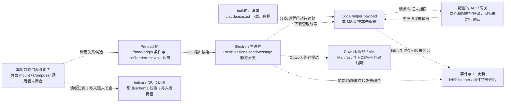

# 用户请求数据流：静态候选关系与证据边界

> **分析对象**：Claude Desktop MSIX `2.42304.0.0` 的 ASAR 和打包 Web 资源。JS 来自压缩 bundle 的静态片段与 REA 关系分析，不是原始厂商源码。
> **证据级别**：候选静态路径。除明确标注的代码观察外，关系没有由运行时跟踪确认；重建代码不能作为产品行为、安全属性或网络效果保证。覆盖纠错和待补项见 [覆盖审计](analysis-coverage-audit-2026-10-18.md)。

---

## 一、端到端候选结构与未闭合边

下图只表示在包内找到的静态组件/代码线索。虚线箭头表示待确认的候选关系；它不是某一次用户请求的运行时追踪。尤其是 helper payload 不在当前 MSIX 样本中，图中的 helper、API 与回传边都不能视为已经实际执行。



---

## 二、 阶段 1~3：前端编辑、传输封装与 Preload frame/origin 条件

### 2.1 前端传输函数线索（`cef1e6037-8DivyY4m.js`）
包内有 ProseMirror + TipTap 依赖；当前 REA 还没有把具体页面挂载、编辑器提交与业务 store 完整连通。下面的 `Kn()` 片段只支持传输函数调用关系：
- **原子节点提取**：输入框中通过 `@` 引用的文件、目录及 MCP 资源，被解析为结构化的 `attachments` 与 `sessionMentions`。
- **草稿存储边界**：当前 `ion-dist/index.html` 从 IndexedDB `keyval-store`/`keyval` 预读 `store:chat-draft:chorus-unified-composer`；页面另用 localStorage 读取独立的 `chat-draft-write-signal`。检索未发现文中所称的 `localStorage.getItem("store:chat-draft:chorus-unified-composer")`，发送后是否同步删除草稿仍待追踪。
- **传输方法 `Kn(t, ...n)` 的逆向切片**：
```javascript
// 摘自 resources/ion-dist/assets/v1/cef1e6037-8DivyY4m.js:22861
async function Kn(t, ...n) {
  let [r, i, a, o, s, l, u, d, f, p, m, h, g, _, v, y, b, ee, x] = n;
  let S = c?.sendMessage;
  if (!S) {
    throw Object.assign(
      new Error("localTransport.send: LocalSessions.sendMessage bridge binding is absent"),
      { code: "desktop_bridge_missing" }
    );
  }
  let te = f?.length ? await me(f) : void 0; // 处理附件二进制流
  let C = x ? [{ personSent: true }] : [];
  // 调用挂载在 globalThis["claude.web"].LocalSessions 上的 sendMessage
  await S(r, i, xe(o ?? []), u, te, m, h, a, g && true, _, v, t, typeof g == "string" ? g : void 0, b, ...C);
}
```

### 2.2 Preload 层的帧与 origin 条件（`mainView.js`）
当前 bundle 中存在由 preload 暴露 `LocalSessions.sendMessage`、调用 `ipcRenderer.invoke()` 的静态代码，也存在 frame 身份和 origin/hostname 条件。下方片段是局部摘录，不是完整允许列表；不要用它推导所有可接受 origin。UUID/通道前缀是路由标识，不是加密证据；本文没有找到 IPC payload 加密实现。

```javascript
// 摘自 .vite/build/mainView.js
var k = "$eipc_message$_6010a08f-a0fa-48b4-99da-0689b9e2de7b_$_claude.web_$_";

function r() {
  let e;
  try { e = new URL(window.location.href); } catch { return false; }
  // 1. 比较当前 frame 与 top frame 的标识
  let isTopFrame = ("frameToken" in t.webFrame && t.webFrame.top && "frameToken" in t.webFrame.top)
    ? t.webFrame.top.frameToken === t.webFrame.frameToken
    : t.webFrame.top?.routingId === t.webFrame.routingId;

  // 2. 静态 origin/hostname 条件（此处只摘录部分逻辑）
  let isValidOrigin = e.origin === "https://claude.ai" ||
                      e.origin === "app://localhost" ||
                      e.hostname === "localhost";
  return isTopFrame && isValidOrigin;
}

Tn = {
  sendMessage(t, n, r, i, a, o, s, c, l, u, d, f, p, m, h) {
    // 动态拼接带 UUID 隔离的 IPC 通道全称
    return e.ipcRenderer.invoke(k + "LocalSessions_$_sendMessage", t, n, r, i, a, o, s, c, l, u, d, f, p, m, h);
  }
};
```

---

## 三、 阶段 4：主进程核心路由决议（`index.chunk-Bn6onBlX.js`）

当前 bundle 中可见 `LocalSessions.sendMessage` 的主进程处理方法及若干条件分支。下面是静态代码线索，本文没有捕获一次真实调用的分支顺序或返回结果：

### 3.1 `sendMessage` 中可见的条件分支
方法代码包含以下检查/分支；其运行时触发频率、先后顺序和完整副作用未验证：
1. **云端迁移保护**：`this.isMovingToCloud(e)`，若会话正同步至云端，直接拒绝新输入。
2. **CrashLoop 熔断保护**：
   ```javascript
   if (this.cliCrashLoopGuard.isParked(e)) {
     return { delivered: false, reason: "Claude Code keeps crashing on this machine; automatic restarts are paused until the user sends a message." };
   }
   ```
3. **内置 Slash 命令分支**：
   - `/remote-control` 或 `/rc` 命中 `handleRemoteControlCommand` 分支线索。
   - `/usage`、`/stats`、`/cost` 命中 `handleStatsCommand` 分支线索。
   - `/color` 命中主题相关处理线索。
   这些本地分支名称本身不证明零 Token 消耗或服务端完全未被调用。
4. **TokenCap 额度与窗口检查**：
   ```javascript
   let g = await t.Ct();
   if (g.over) {
     t.L5.info(`[TokenCap] CCD sendMessage refused for session ${e}: ${g.used}/${g.cap} tokens in ${g.windowHours}h window`);
     throw new Error(t.xt(g));
   }
   ```

### 3.2 本地 backend 分支中的 CWD 检查
代码在 `backend.kind === "local"` 条件下调用 `realpath`，并对 `ENOENT` 分支做处理。该静态片段不证明某个真实会话已触发该路径：
```javascript
if (u.backend.kind === "local") {
  try {
    await fs.promises.realpath(u.cwd);
  } catch (n) {
    if (n?.code === "ENOENT") {
      // 记录 CWD 丢失事件并调用对应处理分支
      t.cz("desktop_ccd_hotpath_cwd_gone_detected", { session_id: e, cwd: u.cwd });
      return this.refuseSendForMissingCwd(u, { reason: "The project folder no longer exists." });
    }
  }
}
```

---

## 四、 阶段 5：Code helper、凭证与 Windows App Job 证据边界

当前 `app.asar` 的 buildPin 元数据指向单独下载的 Code helper `claude.exe.zst`。MSIX 中的 245 MB `app\Claude.exe` 是 Electron 桌面 host，不能当作该 helper。冷启动、子进程选择和 helper 生命周期仍需沿当前版本调用点追踪。

### 4.1 凭据 FD 的结论尚未成立
`HostLoopProcessManager.ts` 是本仓库分析重建稿，不是厂商源文件；其中临时文件、`unlinkSync` 和 FD 处理不能当作产品实现。当前 `2.42304.0.0` ASAR 中没有 `index.chunk-YBFVQBQ_.js` 这一历史 chunk 名，也没有 `stageCredentialFd` 标识。通用 `unlinkSync` 命中不能证明它删除凭据文件；子进程 `spawn` 参数、继承标志和真实凭据来源仍需逐调用点确认。

### 4.2 当前样本有 App Job 线索，但不是“按 PID 强制绑定”证明
当前 `.vite/build/index.pre.js` 包含一个受 MSIX 状态和配置 flag 控制的 `joinAppJob()` 调用；该调用不传 `child.pid`。`.vite/build/index.chunk-lzaSYO3Q.js` 另含 `isProcessInAppJob(pid)` 检查逻辑，只检查首个观察到的 child，并在结果为否时记录告警。它们是此前 HostLoop 重建稿没有覆盖到的产品级静态线索，但没有证明 Code helper 一定属于该 Job、所有子进程都继承，或父进程退出时一定由内核回收。

---

## 五、 阶段 6 & 7：消息输入与 Stream-JSON 控制协议线索

主进程 bundle 中可见输入流、子进程管理和结构化消息相关线索；实际 helper payload 缺失，本文也没有运行时捕获进程启动、管道绑定或消息收发。

### 5.1 用户消息入队 (`enqueueCliInput`)
```javascript
// 摘自 index.chunk-Bn6onBlX.js:1781008
let K = {
  type: "user",
  uuid: G,
  session_id: x,
  parent_tool_use_id: null,
  client_platform: "desktop_app",
  timestamp: (new Date).toISOString(),
  message: {
    role: "user",
    content: ie // 文本与图片 Payload
  }
};
this.enqueueCliInput(u, u.inputStream, K, { machineSent: !p });
```
片段显示该消息对象被交给 `u.inputStream.enqueue(K)`。仅凭此处不能确认 `u` 在目标分支中对应哪个子进程、流最终绑定到何种 OS pipe、序列化字节内容或写入是否成功；“直接写入 helper stdin”应等具体 spawn/stream 绑定闭合后再下结论。

### 5.2 `can_use_tool` 名称与审批路径线索
包内静态字符串/局部代码出现 `can_use_tool`、`local_exec_consent` 和控制响应相关标签。它们支持“存在相关协议/UI 处理代码”的判断；当前证据没有把 helper 输出、主进程 handler、具体审批组件、用户决策和 helper 输入完整串成一次往返。旧图中的按钮名称、字段示例、独立 `WebContentsView`、执行结果与拒绝后的规划行为均不应作为已确认产品行为引用。

### 5.3 `host_auth_token_refresh` 是协议/回调线索，不是 401 热续约证明
当前包内 SDK wrapper 含 `host_auth_token_refresh` subtype 与 `getHostAuthToken` 回调处理代码。这能证明静态协议分支存在；当前样本没有证明它必定由 401 触发、能向企业 IDP 换新 token、重建连接并无感重试，也没有运行时捕获刷新顺序和失败处理。

---

## 六、 阶段 8 & 9：事件分发与 Worker 画布绘制线索

包内存在消息事件发射及前端事件通道线索；当前没有证据确认模型响应的 SSE 如何由 helper 解析、如何经过主进程 IPC 到达具体页面组件：

### 6.1 主进程广播事件
```javascript
let oe = { type: "message", sessionId: e, message: K };
this.emit("event", oe);
```
这里仅证明片段包含本地事件发射；是否由另一 listener 转成 IPC、由哪些页面订阅，仍需沿注册点和调用者追踪。

### 6.2 Worker 资源线索
1. **Shiki/TextMate (`highlightWorker-DC5uhXj0.js`)**：包内资源包含相关运行时代码和语法资源。尚未追到具体页面创建 Worker、消息 schema、所有语言加载路径或性能数据；不能据此保证“离线高亮”覆盖或杜绝掉帧。
2. **帧数据解码与 OffscreenCanvas 绘制 (`framebufferCanvasWorker-DX2Rs-io.js`)**：
   ```javascript
   // 包内代码调用 ImageDecoder；不可据此断言硬件解码或 GPU 零拷贝
   let decoder = new ImageDecoder({ type: mimeType, data: buffer, transfer: [buffer.buffer] });
   let { image } = await decoder.decode();
   ctx.drawImage(image, 0, 0, width, height);
   image.close(); // 释放解码帧关联资源；不说明物理显存路径
   ```

---

## 七、 阶段 10：会话树存储结构与标题生成线索

### 7.1 本地 IndexedDB 会话树读写线索
当前入口 `index.html` 预读 `claude-conversation-store` 数据库 `trees` 仓库中与会话 UUID 对应的记录；`shared-25` bundle 中可见 `trees`、`meta` 仓库名、`2.2` schema 标记及迁移/清理路径。这里证明本地会话树存储结构存在，但本稿没有追通写入调用者、事务提交时机、记录字段是否包含所有工具输出/Token 统计、加密方式和保留期限。不能表述为“每轮结束都原子写入完整会话”。

### 7.2 异步生成会话摘要标题
包内可以观察到标题生成相关路径，但首轮触发条件、实际执行目标和网络结果尚未跟踪：
- 路径线索 A：包内出现 `/v1/messages` 与标题提示文本；当前未沿调用者确认实际 HTTP 请求、发送时机和目标主机。
- 方式 B：3P router 中存在以 `/dust/generate_session_title` 结尾的匹配项，并调用包内标题生成函数。存在本地 route 不等于离线运行，也不证明其他请求或整个进程的外网访问被阻断。

## 八、仍未闭合的协议与进程生命周期

```mermaid
flowchart LR
    A[主进程消息对象] -. "enqueueCliInput 调用可见" .-> B[u.inputStream]
    B -. "stream 与 OS pipe 的绑定待确认" .-> C[Code helper payload 缺失]
    D[buildPin 下载元数据] -. "helper 管理分支待追" .-> C
    C -. "控制协议标签待运行验证" .-> E[control_request / control_response handlers]
    E -. "UI 与用户决策往返未闭合" .-> F[审批界面]
    C -. "端点/认证请求待运行验证" .-> G[/v1/messages / gateway]
    G -. "响应解析与事件转发未捕获" .-> H[前端消息组件]
```

图中所有连线都是待补证关系；“控制协议标签”“标题请求字符串”以及 `joinAppJob`/`isProcessInAppJob` 等标识不能单独证明对应运行时分支执行。当前主进程/preload 的专项 REA 图仍为 partial，具体覆盖边界见 [覆盖审计](analysis-coverage-audit-2026-10-18.md)。

## 九、相关前端专题

前端资源、入口分块、Worker 和 IndexedDB 的静态盘点见 [REA 架构与前端深度分析](../rea-architecture-frontend-deep-dive.md) 与 [CDS 设计令牌和前端专题](cds-design-tokens-and-frontend-deepdive.md)。这些专题也没有执行客户端或浏览器运行时测试。
