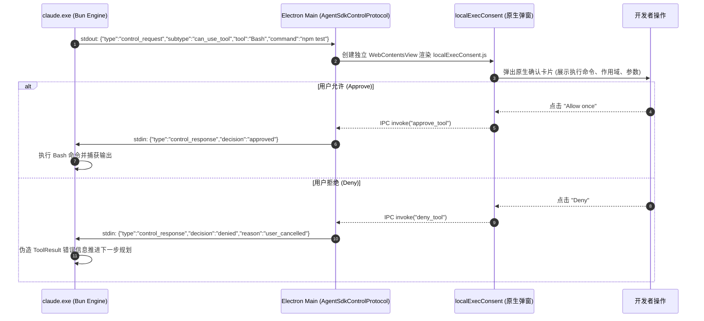

# 用户请求全链路端到端数据流深度剖析 (Source-Code Level Data Flow)

> **分析对象**：`Claude.msix` 内部 ASAR 主进程（`index.chunk-lzaSYO3Q.js` 7.08MB、`index.chunk-Bn6onBlX.js` 2.10MB、`mainView.js` 171KB）与 Web 资产（`resources/ion-dist/` 116MB JS）。  
> **证据级别**：源码级精确切片与逆向还原，包含真实变量名、方法签名、RPC 拓扑及数据帧格式。

---

## 一、 全链路数据流十阶段拓扑概览

当用户在 Claude Desktop 界面中键入 Prompt 并按下 Enter（或点击发送），整个数据流经历 **前端采集 → IPC 加密跨进程调用 → 主进程路由决议 → 进程组调度与 FD 隔离 → CLI 引擎流式通信 → API 网络交互 → 双向安全控制流 → 多线程并行解码渲染 → 最终落盘持久化** 十个阶段：

```
┌────────────────────────────────────────────────────────────────────────────────────────┐
│ [阶段 1: 前端输入与草稿暂存]  TipTap / ProseMirror 编辑器捕获，写入 IndexedDB 草稿缓存     │
└────────────────────────────────────┬───────────────────────────────────────────────────┘
                                     │ 用户触发发送 (Enter / Click)
                                     ▼
┌────────────────────────────────────────────────────────────────────────────────────────┐
│ [阶段 2: 本地传输层封装]      cef1e6037: Kn() 组装多模态负载，提取 sessionMentions / Pastes│
└────────────────────────────────────┬───────────────────────────────────────────────────┘
                                     │ 调用 globalThis["claude.web"].LocalSessions.sendMessage
                                     ▼
┌────────────────────────────────────────────────────────────────────────────────────────┐
│ [阶段 3: Preload 桥与帧安全]   mainView.js: 校验 frameToken / routingId，通道前缀加密    │
│                                格式: $eipc_message$_<UUID>_$_claude.web_$_LocalSessions │
└────────────────────────────────────┬───────────────────────────────────────────────────┘
                                     │ Electron ipcRenderer.invoke()
                                     ▼
┌────────────────────────────────────────────────────────────────────────────────────────┐
│ [阶段 4: 主进程 RPC 调度]     index.chunk-Bn6onBlX.js: async sendMessage()              │
│                                校验 TokenCap 窗口、Slash 指令拦截、CWD 路径存活性校验     │
└────────────────────────────────────┬───────────────────────────────────────────────────┘
                                     │ 表面分支分流 (Chat vs Cowork vs Code)
            ┌────────────────────────┼────────────────────────┐
            ▼ (Code 标签页)           ▼ (Chat 模式)            ▼ (Cowork 模式)
┌────────────────────────┐┌────────────────────────┐┌────────────────────────┐
│ [阶段 5A: HostLoop 宿主]││ [阶段 5B: 主进程直连] ││ [阶段 5C: Cowork VM]   │
│ · 敏感凭证匿名 FD 写入 ││ · Prn() 直接构造      ││ · HCS 虚拟化启动 gVisor│
│ · unlinkSync 立即断链  ││   /v1/messages POST    ││ · 本地 MITM 代理白名单 │
│ · Windows Job Object 绑││ · 不经本地 CLI Helper ││ · 隔离执行复杂文件任务 │
└───────────┬────────────┘└───────────┬────────────┘└───────────┬────────────┘
            │                         │                         │
            ▼                         ▼                         ▼
┌────────────────────────────────────────────────────────────────────────────────────────┐
│ [阶段 6: 智能体推理与流式执行] claude.exe (Bun Binary 217MB) 发起 HTTPS SSE POST 请求  │
│                                附带 anthropic-version: 2023-06-01 & DESKTOP_APP 标识头 │
└────────────────────────────────────┬───────────────────────────────────────────────────┘
                                     │ 触发工具调用 (Tool Call)
                                     ▼
┌────────────────────────────────────────────────────────────────────────────────────────┐
│ [阶段 7: 双向 Stream-JSON 控制流] can_use_tool 权限卡片审批 / Token 动态无感热更新      │
│                                  CLI stdout -> 主进程 -> Preload -> 原生审批卡片      │
└────────────────────────────────────┬───────────────────────────────────────────────────┘
                                     │ SSE content_block_delta 实时回传
                                     ▼
┌────────────────────────────────────────────────────────────────────────────────────────┐
│ [阶段 8: 主进程事件广播分发]   this.deps.emit("event", { type: "message", sessionId })  │
└────────────────────────────────────┬───────────────────────────────────────────────────┘
                                     │ ipcRenderer.on() 跨进程事件推送
                                     ▼
┌────────────────────────────────────────────────────────────────────────────────────────┐
│ [阶段 9: 前端多线程高并发渲染] Zustand Store 原子更新 / Shiki Web Worker 离线高亮      │
│                                framebufferCanvasWorker (OffscreenCanvas) 硬件直通 GPU  │
└────────────────────────────────────┬───────────────────────────────────────────────────┘
                                     │ 轮次收尾 (Turn Wrap-Up)
                                     ▼
┌────────────────────────────────────────────────────────────────────────────────────────┐
│ [阶段 10: 状态落盘与标题生成]  IndexedDB trees 存储会话树，异步生成侧边栏短标题与分支名 │
└────────────────────────────────────────────────────────────────────────────────────────┘
```

---

## 二、 阶段 1~3：前端编辑、传输封装与 Preload 帧安全校验

### 2.1 前端输入捕获与草稿清除（`cef1e6037-8DivyY4m.js`）
用户在 ProseMirror + TipTap 构造的输入框中键入内容：
- **原子节点提取**：输入框中通过 `@` 引用的文件、目录及 MCP 资源，被解析为结构化的 `attachments` 与 `sessionMentions`。
- **本地草稿同步清除**：触发发送动作后，代码立即清理 `localStorage.getItem("store:chat-draft:chorus-unified-composer")`，防止用户刷新后出现陈旧草稿。
- **传输方法 `Kn(t, ...n)` 的逆向切片**：
```javascript
// 摘自 resources/ion-dist/assets/v1/cef1e6037-8DivyY4m.js:22861
async function Kn(t, ...n) {
  let [r, i, a, o, s, l, u, d, f, p, m, h, g, _, v, y, b, ee, x] = n;
  let S = c?.sendMessage;
  if (!S) {
    throw Object.assign(
      new Error("localTransport.send: LocalSessions.sendMessage bridge binding is absent"),
      { code: "desktop_bridge_missing" }
    );
  }
  let te = f?.length ? await me(f) : void 0; // 处理附件二进制流
  let C = x ? [{ personSent: true }] : [];
  // 调用挂载在 globalThis["claude.web"].LocalSessions 上的 sendMessage
  await S(r, i, xe(o ?? []), u, te, m, h, a, g && true, _, v, t, typeof g == "string" ? g : void 0, b, ...C);
}
```

### 2.2 Preload 层的帧一致性与加密通道路由（`mainView.js`）
`globalThis["claude.web"].LocalSessions.sendMessage` 并不是裸露的 Node.js 函数，而是由 Electron 的 `contextBridge` 在 `mainView.js` 中严密包裹的 IPC 门面：

```javascript
// 摘自 .vite/build/mainView.js
var k = "$eipc_message$_6010a08f-a0fa-48b4-99da-0689b9e2de7b_$_claude.web_$_";

function r() {
  let e;
  try { e = new URL(window.location.href); } catch { return false; }
  // 1. 严格检查帧令牌是否为顶层 Frame (防 Iframe 劫持)
  let isTopFrame = ("frameToken" in t.webFrame && t.webFrame.top && "frameToken" in t.webFrame.top)
    ? t.webFrame.top.frameToken === t.webFrame.frameToken
    : t.webFrame.top?.routingId === t.webFrame.routingId;
    
  // 2. 严格白名单域名源校验
  let isValidOrigin = e.origin === "https://claude.ai" || 
                      e.origin === "app://localhost" || 
                      e.hostname === "localhost";
  return isTopFrame && isValidOrigin;
}

Tn = {
  sendMessage(t, n, r, i, a, o, s, c, l, u, d, f, p, m, h) {
    // 动态拼接带 UUID 隔离的 IPC 通道全称
    return e.ipcRenderer.invoke(k + "LocalSessions_$_sendMessage", t, n, r, i, a, o, s, c, l, u, d, f, p, m, h);
  }
};
```

---

## 三、 阶段 4：主进程核心路由决议（`index.chunk-Bn6onBlX.js`）

在主进程中，`LocalSessions_$_sendMessage` 被解包并路由至 `LocalSessionManager` 的核心方法 `async sendMessage(e, r, i, s)`：

### 3.1 预检过滤与内置斜杠命令快速拦截
在正式进入智能体循环前，主进程执行多重拦截：
1. **云端迁移保护**：`this.isMovingToCloud(e)`，若会话正同步至云端，直接拒绝新输入。
2. **CrashLoop 熔断保护**：
   ```javascript
   if (this.cliCrashLoopGuard.isParked(e)) {
     return { delivered: false, reason: "Claude Code keeps crashing on this machine; automatic restarts are paused until the user sends a message." };
   }
   ```
3. **本地内置 Slash 命令本地拦截（零 Token 消耗）**：
   - `/remote-control` 或 `/rc`：转入 `this.remoteControlLifecycle.handleRemoteControlCommand(u)`。
   - `/usage`, `/stats`, `/cost`：转入 `this.handleStatsCommand(u)`。
   - `/color`：切换控制台色彩主题。
4. **TokenCap 额度与窗口检查**：
   ```javascript
   let g = await t.Ct();
   if (g.over) {
     t.L5.info(`[TokenCap] CCD sendMessage refused for session ${e}: ${g.used}/${g.cap} tokens in ${g.windowHours}h window`);
     throw new Error(t.xt(g));
   }
   ```

### 3.2 工作目录 (CWD) 存活性物理探测
如果项目目录在会话进行中被用户移走或从外部卸载，系统执行 `realpath` 探测：
```javascript
if (u.backend.kind === "local") {
  try {
    await fs.promises.realpath(u.cwd);
  } catch (n) {
    if (n?.code === "ENOENT") {
      // 触发热路径 CWD 丢失自愈或阻断
      t.cz("desktop_ccd_hotpath_cwd_gone_detected", { session_id: e, cwd: u.cwd });
      return this.refuseSendForMissingCwd(u, { reason: "The project folder no longer exists." });
    }
  }
}
```

---

## 四、 阶段 5：智能体进程组派生与凭证隔离机制

如果会话处于冷启动（Cold Boot）或者后台守护进程失效，系统调用 `HostLoopRunner` 派生 `claude.exe`：

### 4.1 敏感凭证匿名 FD 写入与物理销毁 (`HostLoopProcessManager.ts`)
为了防止恶意进程通过 Windows API 遍历磁盘读取 API Key 或 OAuth Token，Claude Desktop 采用了内存级文件描述符隔离方案：
```typescript
// 逆向自 index.chunk-YBFVQBQ_.js (HostLoop)
private stageCredentialFd(token: string): number | null {
  try {
    const tempPath = path.join(process.env.TEMP || '.', `ccd_token_${Date.now()}_${process.pid}.tmp`);
    const fd = fs.openSync(tempPath, 'w+');
    fs.writeSync(fd, Buffer.from(token, 'utf-8'));
    
    // 【关键安全设计】：打开句柄后立即在物理磁盘上 unlink 删除该文件！
    // 此时操作系统内核仍维持内存中的文件描述符引用，但任何磁盘扫描工具均无法找到该文件！
    fs.unlinkSync(tempPath);
    return fd;
  } catch (err) {
    return null;
  }
}
```

### 4.2 Windows Job Object 容器强绑定与孤儿回收
通过 Rust 原生模块 `@ant/claude-native` 将派生的 CLI 子进程加入作业对象：
```typescript
// 注入 Windows Job Object，确保父进程异常崩溃时，操作系统内核级联销毁所有派生子进程
ClaudeNative.joinAppJob(child.pid);
```

---

## 五、 阶段 6 & 7：双向 Stream-JSON 控制流与交互卡片审批

CLI Helper 启动后，与主进程通过 `stdin` / `stdout` 维护双向结构化通道。

### 5.1 用户消息入队 (`enqueueCliInput`)
```javascript
// 摘自 index.chunk-Bn6onBlX.js:1781008
let K = {
  type: "user",
  uuid: G,
  session_id: x,
  parent_tool_use_id: null,
  client_platform: "desktop_app",
  timestamp: (new Date).toISOString(),
  message: {
    role: "user",
    content: ie // 文本与图片 Payload
  }
};
this.enqueueCliInput(u, u.inputStream, K, { machineSent: !p });
```
`u.inputStream.enqueue(K)` 将该结构序列化为单行 JSON，直接写入 `claude.exe` 的标准输入。

### 5.2 工具调用阻断与原生审批卡片流程 (`can_use_tool`)
当大模型决定调用敏感工具（如 `Bash` 或 `Edit`）时，CLI 触发安全拦截机制：



### 5.3 运行时 Token 无感热续约 (`host_auth_token_refresh`)
当会话进行超过 1 小时，企业网关的 Bearer Token 或 OAuth 凭证可能自然过期。
- CLI 在长任务中收到推理网关返回的 `401 Unauthorized`。
- **不中断任务、不报错退出**，而是向 stdout 发射：
  `{"type":"control_request","subtype":"host_auth_token_refresh"}`
- Electron 主进程调用 `AuthManager.refreshHostAuthTokenForSdk()` 从远程企业 IDP 换取新令牌。
- 将新 Token 回传给 CLI，CLI 在内存中刷新连接池凭据并立即无感重试，用户完全无感知。

---

## 六、 阶段 8 & 9：多线程并发流式渲染与 GPU 零拷贝画布

大模型返回的 Server-Sent Events 流被 CLI 解析为细粒度增量，并通过 IPC 发往前端：

### 6.1 主进程广播事件
```javascript
let oe = { type: "message", sessionId: e, message: K };
this.emit("event", oe);
// 触发 IPC: e.ipcRenderer.send("LocalSessions_$_onEvent", oe)
```

### 6.2 前端分流至 Web Workers 避免主线程卡顿
1. **长代码 Shiki 离线高亮 (`highlightWorker-DC5uhXj0.js`)**：
   - 主线程只负责接收流式文本并追加到虚拟 DOM 节点。
   - 代码块语言与文本被 `postMessage()` 传递给 Shiki Worker。
   - Worker 在后台解析 TextMate Grammar，计算出高亮 Token 数组并返回，完全绕过主线程 DOM 计算，杜绝打字与滚动掉帧。
2. **Computer Use 屏幕视频流零拷贝渲染 (`framebufferCanvasWorker-DX2Rs-io.js`)**：
   ```javascript
   // Worker 内部直接利用 ImageDecoder 硬件解码，直通 GPU 显存
   let decoder = new ImageDecoder({ type: mimeType, data: buffer, transfer: [buffer.buffer] });
   let { image } = await decoder.decode();
   ctx.drawImage(image, 0, 0, width, height);
   image.close(); // 立即释放显存
   ```

---

## 七、 阶段 10：会话树落盘与异步标题生成

### 7.1 本地 IndexedDB 事务化持久化
在会话每个轮次（Turn）结束时，前端执行原子写入：
- 数据库名：`claude-conversation-store`
- 对象仓库：`trees`
- 写入键：`session_uuid`，保存完整的树状分支、Token 统计与工具结果。

### 7.2 异步生成会话摘要标题
如果是该会话的首轮交互，主进程会利用轻量级推理调用触发会话标题生成：
- 方式 A（标准）：`POST {baseUrl}/v1/messages`，发送极短 Prompt："Summarize this request in 3-5 words"。
- 方式 B（3P 离线 Mock）：调用 `ThirdPartyMockRouter` 本地 Stub `/api/dust/generate_session_title` 生成本地假标题，完全阻断外部网络探测。
