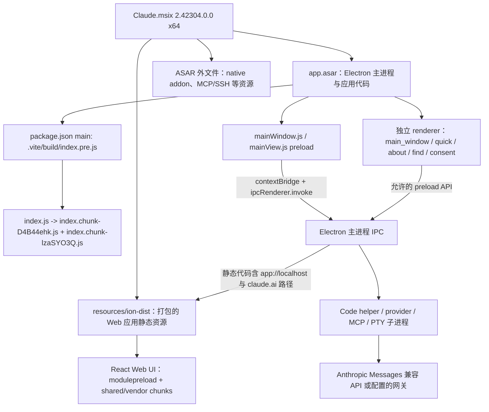

# REA 深入分析：Claude Desktop 2.42304.0.0 架构与前端

> 分析对象：本仓库随附分析的 Windows MSIX 样本（文件名 `Claude.msix`），AppxManifest 版本 **2.42304.0.0 x64**，内部 `@ant/desktop` 版本 **2.42304.0**。REA 版本 **6.5.0**。仓库忽略 MSIX 与解包目录；复现时需自行准备相同版本样本。
>
> 证据级别：**直接观察**表示从包清单/HTML/JS/CSS 读取到；**REA 静态关系**表示 REA 从静态语法构造的候选关系；**推断**表示依据多处文件组合得到；**未验证**表示没有实际启动或联网测试。

## 核心结论

1. 本目录的应用包是 **2.42304.0.0**，原始架构稿分析的是 **2.37337.1.0**。前端 bundle 哈希、目录内容均已变化；原稿应作为旧版记录阅读，不能把旧版文件名和数量直接套到当前包。
2. 当前 MSIX 分成两块重要的前端代码：`app.asar` 中的 Electron 桌面壳与 preload，和 ASAR 外的 `resources/ion-dist` 大型 Web 应用资源。两者都在包内，但它们的本地存在不等于整个产品可离线完成登录和模型请求。
3. 当前 `ion-dist` 的 HTML 引导 React 应用，模块清单显示 Zustand、QueryClient、TipTap/ProseMirror 等依赖；CSS 含 Monaco diff 样式。多种 Worker 将语法高亮、画布绘制、压缩等工作从主线程分开。
4. REA 对当前 `app.asar` 完成了 452 个源文件的分析输入和应用图构建；两个大型源在语义分析阶段触发 worker heap 限制，图覆盖仍不完整。`ion-dist` 单独分析了 6 个指定 JS 文件，另有 3,614 个已盘点文件没有进入该次代码分析。当前 `claude.exe` 只做了通用 PE 资源清点，未进行可执行文件语义/原生代码分析。
5. 这些是静态证据。REA 没有启动 Electron、执行 bundle、触发 IPC、调用网关或证明策略实际生效。

## REA 是怎样“解析架构”的

REA 的应用分析不是运行客户端后观察行为，而是从一个固定包构造可追溯的静态证据：

1. **盘点容器**：识别 ASAR/目录、建立文件清单和哈希。当前 `app.asar` 的 SHA-256 为 `8f4d3dec5e4f3ddffb150321060b18807d83a40f3a65618fe4f29325379da9db`。
2. **完整性核验**：默认严格检查发现 ASAR 声明的 unpacked 文件哈希与磁盘字节不符，所以使用 `record-and-continue` 继续读取。这个选项只允许继续分析，并不会修复或信任那些字节。
3. **解析源文件**：按 ASAR 内的路径读取 JavaScript、HTML 和模块清单，识别 import/require、字符串端点、Electron API、配置、worker、子进程等静态结构。分析时没有执行入口代码或 Rspack/Webpack runtime。
4. **构造关系图**：输出 `JavaScriptApplicationGraph` 与受预算限制的语义关系图。图里的“调用/端点/IPC 候选”表示源码结构关系，不等于启动时一定可达或实际调用。
5. **封存 Evidence**：把包哈希、所选源、矛盾和限制绑定到 Evidence ID。后续复查应保留相同版本、哈希、命令和 Evidence ID。

本轮对当前 `app.asar` 的 REA Evidence ID 是 `ev_047a8e39ac1487c8a803f675db5d374a4a4eb9772b487f4e567d00cd93882bf0`；对 `ion-dist` 6 个前端文件的 Evidence ID 是 `ev_d8151593574491f547f089baa1376b2602064febb931203c8132928ef447f58a`，目录 SHA-256 为 `c52bb551a26216395cb6616650b86af315b30c721e547b3c6cf597b194dc2521`。

当前 helper `extracted_msix/app/claude.exe` 的大小为 **245,756,240 字节**，REA 通用 PE 检查 Evidence ID 为 `ev_cabda353e071c89a06596a3b047fc60716947191f2dfc719b7bdb2fe1bb9cbdb`，SHA-256 为 `84b6beb90538fcc401197130f888d121d92a9ce38e493ff7bad3b69cc1d8cc1d`。该次 `inspect-artifact` 只完成 `inventory_artifact`；REA 明确列出 `inspect_managed_artifact` 和 `open_binary` 为未执行的后续探针。因此本文中的 helper 行为线索来自 `app.asar` 的启动/配置代码和包内元数据，不代表已解析 helper 内部实现。

### 当前包的覆盖限制

- `app.asar` 清单中有 **452 个被选入分析的源文件**。总语义节点预算为 10,000，每文件 1,000。
- `.vite/build/index.chunk-lzaSYO3Q.js` 与 `resources/office365-mcp/office365-mcp-stdio.mjs` 在语义阶段触发 REA owned worker heap 限制。不能把这两份文件未完整建图理解成“没有功能”或“没有调用关系”。
- `ion-dist` 的那次专门分析只选了 `index-D3kGySMO.js`、`vendor-frame-DfPJ1QmD.js`、`vendor-all-0-CTKbbUUg.js`、`vendor-query-Dqcf4jOo.js`、`vendor-router-DOqjo6Uj.js`、`c2a6d07ee-BsCuu8dD.js` 六个文件；剩余 3,614 个盘点文件的关系没有被那次语义分析覆盖。
- 当前 `app.asar` 有 5 个完整性矛盾：`node-pty` 的两个 `.node` 文件、内置 `github-mcp-server.exe`、Office 365 MCP 的 `msal-node-runtime.node` 和 `msalruntime.dll`。REA 将观测到的字节标为 `observed-untrusted`。这只能说明声明哈希与当前字节不一致；不能据此认定被篡改，也不能将这些字节当作已验证等价物。
- `resources/ion-dist` 内没有 `.map` source map 文件。多数业务代码是哈希命名的压缩 bundle，变量、原始组件名和 JSX/TS 源码映射有限。
- REA 报告指出 `main_window/index.html` 有 2 段 inline JavaScript 没有进入语义分析；动态 IPC 通道、动态属性和运行时注册仍会有未知项。
- 当前 `claude.exe` 的 REA 检查只保留 PE 根清单/通用字节盘点，并未运行格式专属 managed/native 代码分析。可执行文件大小不能代表分析覆盖深度。

## 当前版本的桌面结构



### Electron 主进程与 preload

- **直接观察**：`package.json` 声明 `@ant/desktop` 2.42304.0，`main` 为 `.vite/build/index.pre.js`。它约 930 KB；`.vite/build/index.js` 是 638 字节的轻量入口，继续加载两个 chunk。当前核心 chunk 中最大的一个是 `index.chunk-lzaSYO3Q.js`，约 7.08 MB；另外有 356 个 `index.chunk-*` 文件。
- 当前主进程核心 chunk 可检索到 `inferenceProvider`、`inferenceGatewayBaseUrl`、`ANTHROPIC_BASE_URL`、`CLAUDE_CODE_LOCAL_BINARY`、`downloads.claude.ai`、`/v1/messages`、`app://localhost` 和 `claude.ai`。这些字符串与代码片段说明对应实现存在于当前包中，是否在某个组织策略/运行时分支下启用仍需动态验证。
- `inferenceGatewayBaseUrl` 的配置元数据含有 `readers: desktop, m365, code`，同时标注 `scopes: [3p]` 与 `executionTarget: desktop`。这表示包内元数据对范围有约束；不要把配置键存在误读成所有 1P/3P 桌面模式都开放同一能力。
- `CLAUDE_CODE_LOCAL_BINARY` 对应的代码片段记录了本地二进制覆盖分支和 `[CCD] LOCAL OVERRIDE` 日志。它证明当前包内有该分支，不证明它是 Anthropic 面向客户承诺的稳定离线部署接口。
- `mainWindow.js`、`mainView.js` 都包含 `contextBridge` 与 `ipcRenderer.invoke`；preload 通过命名对象向页面暴露接口，IPC 通道带有专用前缀。静态代码包含对 `https://claude.ai`、`app://localhost` 等 origin 的检查。REA 明确不把这些字符串检查等同完整的授权安全策略。
- Electron renderer 的本地壳是独立页面：当前 `main_window/index.html` 加载 `main-9C0encc1.js`，其中再映射到 `MainWindowPage-BM1J3SeB.js`。HTML 直接包含标题栏/侧栏 boot placeholder，先构造根节点，再交由 React 组件接管。

## 前端代码拆解

### 1. 两层前端：桌面壳与 ion-dist SPA

**桌面壳**位于 `app.asar/.vite/renderer/main_window/`，职责偏窗口框架、标题栏、拖拽区域和桌面桥接。它有自己的 preload 和 renderer bundle。

**ion-dist** 位于 `app/resources/ion-dist/`，是大得多的 Web 应用资源目录。当前目录清单约有 3,588 个 `.js`、25 个 `.css`、5 个 `.html`、27 个 `.json` 文件；`.js` 总体约 116 MB。`index.html` 的 `data-version="1.0.0"` 是这套 Web 资源自身的标记，不是 MSIX 版本号。

### 2. 首屏：静态骨架、草稿和缓存预热

- `ion-dist/index.html` 的模块入口是 `/assets/v1/index-D3kGySMO.js`，并预加载 `vendor-frame`、`vendor-all`、`vendor-query`、`vendor-router`、`vendor-prosemirror`、`vendor-tiptap` 以及一组 `shared-*` 模块。入口再引用动态 chunk。这个结构是代码分块和启动依赖的直接证据，不意味着每个 chunk 首屏都会执行。
- HTML 先提供 `#root`、`#portal-root`、侧栏 skeleton 和 `static-composer` 等 DOM，再加载 React bundle。多个 `data-boot-*` 标记控制 placeholder 显示状态，目的是让 shell 能先绘制，再等待应用初始化。
- Inline 预热逻辑会从 IndexedDB 读取 query cache，并尝试恢复聊天草稿；HTML 中还存在检查过期 entry、必要时重新加载的逻辑。它说明客户端有本地缓存/草稿启动路径，不证明消息、模型或完整业务能离线工作。
- `index.html` 还包含浏览器能力不足时的提示元素。它与 boot placeholder 一起构成 JS 失败或资源更新时的前端降级入口。

### 从 HTML 入口追前端启动与数据预热

这条链路由包内 HTML、ES module 引用和 bundle 字符串拼出。它是静态重建，不代表已经在运行中的窗口里观测到同样的时序。

1. **入口与静态骨架**：ion-dist 的 **index.html** 提供 **#root**、**#portal-root**、**#js-cannot-start**、侧栏 skeleton 和 **static-composer**。桌面 boot placeholder 通过 data-boot 前缀属性等待 UI 状态；JS 不启动时还有单独的错误提示节点。
2. **同步预热本地缓存**：inline 脚本打开 IndexedDB 数据库 **keyval-store** 的 **keyval** object store，分别读取 **react-query-cache** 和 **store:chat-draft:chorus-unified-composer**。新建会话相关路由仅在发现 session key 时才准备草稿预读 Promise；数据库失败时把结果收敛为未命中，并设置 preload settled 标记。
3. **入口模块与分块**：HTML 加载 **assets/v1/index-D3kGySMO.js**，并声明 **vendor-frame**、**vendor-query**、**vendor-router**、ProseMirror/Tiptap 和多个 shared chunk 为 modulepreload。它证明这些本地构建产物被列作入口依赖/预加载资源；不能据此断言每个页面都会执行每个模块。
4. **组件状态与服务数据**：vendor bundle 中包含 React DOM 19.2.4、QueryClient/QueryClientProvider、脱水/恢复相关函数，以及 Zustand 的外部 store 订阅和 persist middleware。**shared-25** 还要求特定 QueryClient 安装 bootstrap-settle recorder。组合起来，证据支持“UI store + Query 数据缓存 + IndexedDB 启动预热”这三层；具体业务 store、query key 和失效规则仍未从入口完整追通。
5. **桌面能力边界**：ion-dist 的 shared bundle 可见 **window.desktopPreferredLanguages**、**window.claudeAppBindings** 等桥接能力标记；对 **assets/v1** 做字面搜索没有发现 **ipcRenderer**。这与 Electron preload 暴露窄接口的结构相符，但压缩、别名和动态调用使“搜索不到”不能证明整个 renderer 没有其他通道。

有两个容易误读的代码命中需要特别区分：React DOM 的 **createRoot**/**hydrateRoot** 定义证明运行库被打包；**c2a6d07ee-BsCuu8dD.js** 中同名的 **createRoot** 实际用于 TextMate 语法 scope tree。REA 当前六文件语义分析没有把 ion-dist 的 React DOM 根调用与具体业务组件完整连成一条调用链，因此报告不把某个页面的 mount 函数写成已证实事实。

### 3. React、状态和数据缓存

- **vendor-frame-DfPJ1QmD.js** 含 React DOM 19.2.4 的 **createRoot** 与 **hydrateRoot** 实现；**vendor-query** 含 QueryClientProvider 与缓存脱水/恢复代码。它们确认这些前端运行库随包提供，但本轮静态关系图没有证明哪个具体页面入口调用了哪个 root API。
- `vendor-all-0-CTKbbUUg.js` 含 `zustand` 与 `useSyncExternalStore` 标记；`vendor-query-Dqcf4jOo.js` 含 `QueryClient`。结合 HTML 的本地 query-cache 预热，可把它理解成“组件状态 + 服务端数据缓存”两层设计。仅凭 vendor 包不能确认每个 store 的业务字段、缓存键或失效规则。
- `vendor-prosemirror`、`vendor-tiptap` 文件被 HTML preload，表明编辑器相关依赖随包提供。`c5aee9dbd-B55U_qvj.css` 含 `.monaco-editor` 与 `.monaco-diff-editor` 样式，证明 Monaco 相关样式在包内；要确认某页面何时创建编辑器实例，仍需追踪对应懒加载模块和运行时。

### 4. 设计系统与样式

- 当前 `ion-dist/assets/v1` 有 25 个 CSS 文件，其中 `c6a992d55-sXiDGMFQ.css` 约 1.71 MB、`shared-styles-Bl9zqrv-.css` 约 79 KB、Monaco 样式分块约 67 KB 和 62 KB。
- 对这 25 个 CSS 文件按 `--cds-[a-zA-Z0-9_-]+` 去重，得到 **1,070 个不同名称**。这是变量名词表计数，不等于 1,070 个都在运行时使用或都被定义一次。
- CSS 中能直接找到 `prefers-color-scheme`、`font-variation-settings`、`--cds-surface-1`，且有大批 `--cds-*` 令牌。可以确认设计系统以语义变量和系统明暗模式为基础；对字重/布局视觉效果的精确影响仍应通过浏览器截图和 computed style 验证。

### 5. Worker 的职责拆分

| 文件 | 源码中直接能看到的行为 | 分析边界 |
|---|---|---|
| `highlightWorker-DC5uhXj0.js`（约 1.5 MB） | 可搜索到 Shiki、TextMate、grammar、tokenize 等代码标记 | 包含语法高亮实现的强证据；没有逐个语言 grammar 和调用点做完整映射 |
| `framebufferCanvasWorker-DX2Rs-io.js`（约 2 KB） | 接收 `MessagePort`，校验 `sessionId/seq/width/height/mimeType/Uint8Array`，关联 `canvasId` 与 session；用 `ImageDecoder` 或 `createImageBitmap` 解码，并向 `OffscreenCanvas` 绘制 | 丢弃旧序号帧，保护绘制状态；不能据此称为完整的 GPU 零拷贝链路 |
| `completionGzipWorker-Q_JtDKxH.js`（约 0.6 KB） | 用 `CompressionStream("gzip")` 压缩 `Uint8Array`，经 transfer list 回传结果 | 代码是 gzip 压缩方向；不证明其所有调用场景 |
| `rumEncoder.worker-D8GGzwpc.js`（约 63 KB） | 独立 RUM worker 资源；主入口代码创建 `ant-rum-worker` | 存在不代表运行时遥测一定开启或成功上报 |
| `worker-portable-nQ-kv3bB.js`（约 209 KB） | 包内还有 portable worker 资源 | 本轮没有对其完整语义建图 |

### 6. 用户内容隔离壳

**client-shell-v1.html** 有独立 CSP，指令包含 default-src 'none'、connect-src 'none'，并禁用图片、样式、字体、媒体、frame、worker、object、form 等资源。它从 **window.name** 取出 handshake token 后清空该值，收到带相同 token 且 document 为字符串的 boot 消息后创建 iframe；内层 ready 消息还要匹配 token 和 iframe 的 **contentWindow**，随后双方通过 **MessageChannel** 交换 port。此文件不负责生成 token，生成方和父窗口的其余校验仍需从调用点追踪。

这是某个内容 shell 的隔离设计证据，不是整个 Claude Desktop renderer 都使用同一 CSP，也不能单凭 CSP 断言应用整体没有网络请求。该 shell 仍显式允许 inline/blob scripts，安全效果应按文档来源、父子消息校验和 sandbox 权限组合评估。

## 与内网/离线的关系

- MSIX 中打包了 `ion-dist` 本地前端资源；当前主进程同时包含 `app://localhost` 与 `claude.ai` 两类 origin 相关逻辑。前端本地化解决的是资源供应方式，不自动解决账户认证、模型 API、helper 获取、遥测和更新依赖。
- 当前主进程仍包含 `downloads.claude.ai`、`api.anthropic.com`、`/v1/messages` 等路径和 host 字段。内网部署必须验证目标模式下 provider 配置、helper 文件和认证链；客户端设置开关不能替代出口防火墙策略。
- `inferenceGatewayBaseUrl` 的静态 metadata 有 `3p` scope 标注。上线前应对目标 organization、目标 surface 和策略来源做实测，不要仅以注册表/用户配置里出现该键为通过。
- `client-shell` 的 `connect-src 'none'` 只约束该 iframe shell；MCP、PTY、插件和其他 renderer 仍须分别盘点网络出口。

## 复现本轮 REA 分析

```powershell
rea --version

rea inspect-artifact `
  '.\extracted_msix\app\resources\app.asar' `
  --integrity-policy record-and-continue --format md

rea analyze-javascript-application `
  '.\extracted_msix\app\resources\app.asar' `
  --artifact-format asar --integrity-policy record-and-continue `
  --max-semantic-nodes 10000 --max-semantic-nodes-per-file 1000 --format json
```

对 `ion-dist` 的前端抽样分析需重复提供 `--source-path`；REA 不会自动把所有 import 依赖纳入代码分析。当前已选文件清单和限制见本文件上方 Evidence 记录。未经筛选直接打印完整 graph 会生成极大的输出，适合先用 `--filter-output` 获取 summary，再按选定关系查看。

## 下一步最有价值的深挖

1. 对 7 MB 的 `index.chunk-lzaSYO3Q.js` 单独分段/提高专属 worker heap，优先追踪 Provider、Code helper、IPC 路由与更新/遥测配置；避免把整包语义节点预算继续平均摊薄。
2. 从 `ion-dist/index.html` 出发逐层追踪 `index-D3kGySMO.js`、首个 lazy chunk 和具体 Code/Composer 模块，建立一条可证实的组件—store—API 数据链。
3. 若要判断“能否在内网运行”，在干净 Windows VM 上做安装、首次启动、Code helper、本地网关流式请求和出站抓包验证；静态包分析本身无法替代这四项。

## 相关文件

- [旧版架构原稿](claude-desktop-architecture.md)：对应 Claude Desktop 2.37337.1.0，仅作历史版本依据。
- [前次总结与内网部署判断](README.md)：总体结论和验证清单。
