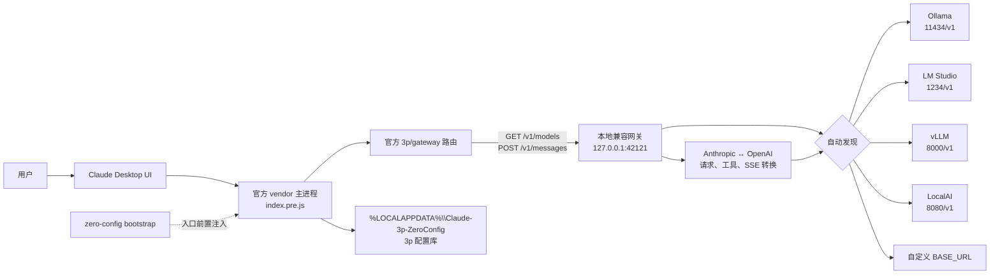
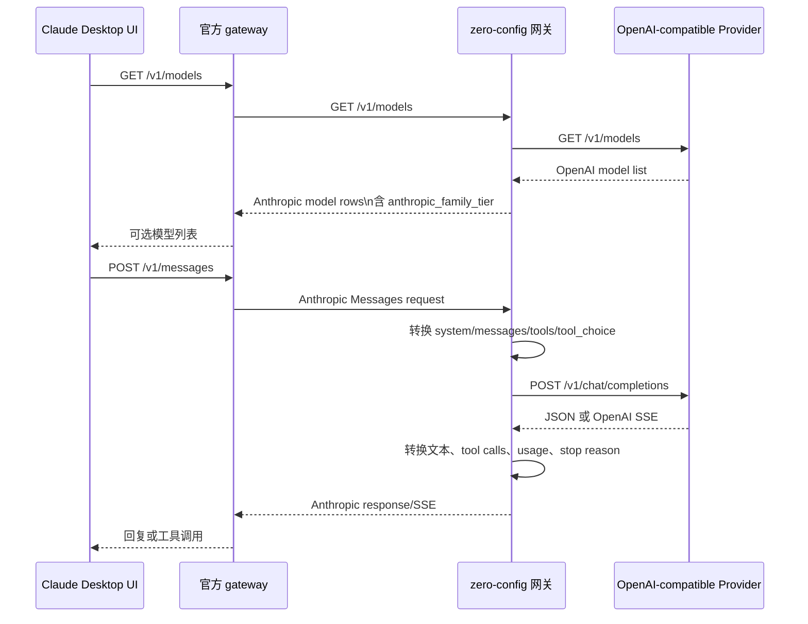
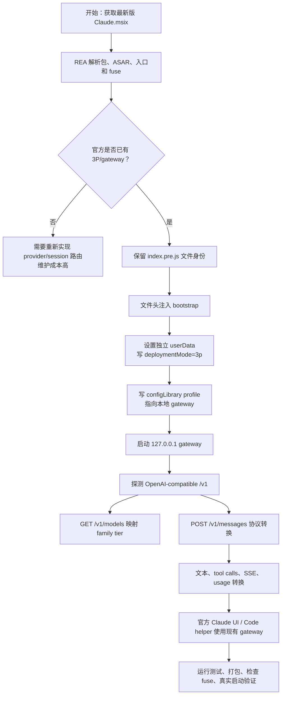

# Claude Desktop 4.4212 第三方模型免配置 EXE 包

这是基于仓库当前 `Claude.msix` 制作的 Windows 研究构建。它保留 Claude Desktop 最新版内置的 `3p/gateway` 分支，在主进程入口前注入一个本地回环兼容层，使 Claude Desktop 可以自动发现并调用 Ollama、LM Studio、vLLM、LocalAI 或其他 OpenAI-compatible 服务。

> 这不是 Anthropic 官方发布包，也不带 Anthropic 的数字签名。构建结果是一个需要 Windows package identity 的松散注册包。

## 1. 快速使用

### 1.1 准备第三方模型服务

任选一个 OpenAI-compatible 服务并启动：

| 服务 | 默认地址 | 说明 |
| --- | --- | --- |
| Ollama | `http://127.0.0.1:11434/v1` | 本地服务通常不需要 API Key |
| LM Studio | `http://127.0.0.1:1234/v1` | 启动 Local Server |
| vLLM | `http://127.0.0.1:8000/v1` | 启动 OpenAI-compatible API |
| LocalAI | `http://127.0.0.1:8080/v1` | 使用 OpenAI-compatible API |

### 1.2 启动 EXE 包

构建完成后进入：

```text
dist\\Claude-ThirdParty-Package\\
```

构建脚本还会生成同级发布压缩包：

```text
dist\\Claude-ThirdParty-Package.zip
```

该 ZIP 包含 `app\\Claude.exe`、松散包 manifest、安装/卸载脚本和本手册，可作为 GitHub Release 资产分发。

双击：

```text
Start-Claude-ThirdParty.cmd
```

脚本会执行以下动作：

1. 注册 `ClaudeThirdPartyZeroConfig` 松散包；
2. 通过 Windows package identity 启动 `app\\Claude.exe`；
3. 自动创建独立数据目录 `%LOCALAPPDATA%\\Claude-3p-ZeroConfig`；
4. 自动写入 `deploymentMode: "3p"` 和 gateway profile；
5. 启动本机 `127.0.0.1:42121` 兼容网关；
6. 探测第三方模型并通过 `/v1/models` 暴露给 Claude Desktop。

如果 `Add-AppxPackage` 返回 `0x80073CFF`，请在 Windows 设置中手动启用 Developer Mode，然后再次运行脚本。本项目不会自动修改系统安全设置或安装证书。

### 1.3 卸载

```powershell
powershell.exe -NoProfile -ExecutionPolicy Bypass -File .\\Uninstall-Claude-ThirdParty.ps1
```

卸载脚本只移除 `ClaudeThirdPartyZeroConfig` 包注册，不删除官方 Claude 的 `%LOCALAPPDATA%\\Claude-3p` 数据。

## 2. 自定义第三方服务

默认探测顺序：

1. `CLAUDE_THIRD_PARTY_BASE_URL`；
2. Ollama：`http://127.0.0.1:11434/v1`；
3. LM Studio：`http://127.0.0.1:1234/v1`；
4. vLLM：`http://127.0.0.1:8000/v1`；
5. LocalAI：`http://127.0.0.1:8080/v1`。

云端 OpenAI-compatible 服务可以在启动前设置：

```powershell
$env:CLAUDE_THIRD_PARTY_BASE_URL = 'https://provider.example.com/v1'
$env:CLAUDE_THIRD_PARTY_API_KEY = '<your-api-key>'
$env:CLAUDE_THIRD_PARTY_MODEL = 'provider-model-id'
.\\Start-Claude-ThirdParty.cmd
```

支持的环境变量：

| 环境变量 | 作用 |
| --- | --- |
| `CLAUDE_THIRD_PARTY_BASE_URL` | 自定义 OpenAI-compatible `/v1` 地址 |
| `CLAUDE_THIRD_PARTY_API_KEY` | 自定义服务的 API Key |
| `CLAUDE_THIRD_PARTY_MODEL` | 固定上游模型 ID |
| `OPENAI_BASE_URL` / `OPENAI_API_BASE` | 兼容 OpenAI 客户端的地址变量 |
| `OPENAI_API_KEY` | OpenAI-compatible 服务 API Key |
| `OPENROUTER_API_KEY` | OpenRouter API Key |
| `CLAUDE_ZERO_CONFIG_PORT` | 本地兼容网关首选端口，默认 `42121` |
| `CLAUDE_ZERO_CONFIG_USER_DATA_DIR` | 覆盖独立配置目录 |
| `CLAUDE_ZERO_CONFIG_DISABLE=1` | 禁用注入网关，直接启动 vendor 应用 |

API Key 只从当前进程环境读取，不写入 Claude Desktop 配置。配置 profile 中的 `local-zero-config` 是本地 gateway schema 所需的占位值，不是云端密钥。

## 3. 系统架构



架构中的两条边界不同：

- **官方路径**：Claude Desktop 仍负责 UI、会话、模型选择、gateway 路由和 Code helper 环境。
- **注入路径**：本项目只负责预置 3P 配置、启动回环网关、发现上游服务和转换协议，不重写约 6.8 MB 的核心压缩 chunk。

## 4. 请求处理流程



### 支持的入口

| HTTP 接口 | 用途 | 当前实现 |
| --- | --- | --- |
| `GET /v1/models` | 模型发现 | 自动探测并增加 `anthropic_family_tier` |
| `POST /v1/messages` | 主消息请求 | 非流式和流式转换 |
| `POST /v1/messages/count_tokens` | token 计数 | 字符数近似，不使用上游 tokenizer |
| `GET /_claude_zero_config/health` | 本地健康检查 | 返回当前探测到的 provider |

### 内容转换范围

- system prompt；
- 文本 content block；
- base64 和 URL 图片；
- Anthropic `tool_use` / `tool_result`；
- OpenAI function tools 和 `tool_choice`；
- OpenAI SSE 文本增量到 Anthropic `text_delta`；
- OpenAI SSE tool call 增量到 Anthropic `input_json_delta`；
- stop reason 和基础 usage。

第三方服务是否真正支持视觉、工具、长上下文、reasoning 或结构化输出，取决于具体上游模型。

## 5. 如何用 REA 解析 Claude.msix

REA 分析的目标是先确认最新版包实际包含什么，再决定最小修改点。分析过程没有执行目标 JavaScript，也没有把目标文件中的文本当作指令。

### 5.1 包级分析

1. 使用 `open_binary` 打开仓库根目录的 `Claude.msix`；
2. 使用 `inspect_artifact` 查看 MSIX 成员、版本、完整性和可疑分支；
3. 使用 `extract_artifact` 将 MSIX 解到独立临时目录；
4. 从 `app\\resources\\app.asar` 继续分析 Electron 应用。

### 5.2 JavaScript 应用图分析

对 `app.asar` 使用 `analyze_javascript_application`，重点查看：

- `.vite/build/index.pre.js`：主进程入口、3P userData 路径和启动顺序；
- `.vite/build/index.chunk-2SHPxESV.js`：provider、gateway、model discovery 和 message request；
- `.vite/build/index.chunk-WNSDfQz8.js`：Code/Cowork 会话和 `ANTHROPIC_BASE_URL` 传播。

由于核心 bundle 很大，REA 返回的应用图是部分覆盖。对具体问题使用 `inspect_analysis_view` 分页读取模块和事实；不能把“图中没有命中”当作功能不存在。

### 5.3 关键静态证据

本次分析记录的 Evidence：

| 分析对象 | Evidence ID | 关键结论 |
| --- | --- | --- |
| `Claude.msix` | `ev_30c308336d8867602a2b5ca3d96a813103331580118bd174157fe1c53f7be485` | MSIX `4.4212.0.0`、成员和完整性 |
| `app.asar` | `ev_db006cd69078f668d1ad0764bb75a8f09179e4b4431043fb189a3d44d373df12` | 651 个相关文件、3P/gateway 静态关系 |
| 原始 `Claude.exe` fuse | `ev_c80969004464b25c2accc996eeff74c74dc170811bb0021435971a80f157dde5` | embedded ASAR integrity 原本启用 |
| 修改后 `Claude.exe` fuse | `ev_3d7e9256f8b027887a29c67e9b5af276f7118909b5ec7f9e054ab24b19881d19` | integrity disabled，OnlyLoadAppFromAsar 保留 |

REA 还确认了以下静态事实：

- 官方已经存在 `gateway` provider 和 `deploymentMode: "3p"`；
- 模型发现支持带 `anthropic_family_tier` 的非 Anthropic 模型 ID；
- 消息请求统一经过 `/v1/messages`；
- Code helper 会继承 provider 的 API host；
- 修改 `app.asar` 后必须关闭 embedded-ASAR integrity fuse，否则 Electron 可能拒绝新归档。

## 6. 如何把 Claude Desktop 改成直接支持第三方模型

推荐采用“保留官方 3P 路由，只补协议和自动配置”的方式，而不是重写模型选择或核心会话逻辑。



实施时应遵循以下顺序：

1. **先用 REA 确认版本和路径**：不要假设旧版 bundle 的文件名或配置字段仍然存在；
2. **优先复用官方分支**：只设置 `deploymentMode`、gateway profile 和 model discovery 所需字段；
3. **入口保持同名**：保留 `.vite/build/index.pre.js`，只在文件头注入，避免改变主模块加载语义；
4. **隔离用户数据**：vendor 会重置 `CLAUDE_USER_DATA_DIR`，因此应拦截 `app.setPath('userData', ...)`，使用独立目录；
5. **实现回环兼容层**：把 Anthropic Messages 转成 OpenAI Chat Completions，再把 JSON/SSE 转回去；
6. **处理 Electron fuse**：重打 `app.asar` 后只关闭 `EnableEmbeddedAsarIntegrityValidation`，保留 `OnlyLoadAppFromAsar`；
7. **保留 package identity**：直接执行解包目录可能导致 Windows/Chromium 初始化后退出，最终应注册松散包或重新签名 MSIX；
8. **验证真实入口**：不能只运行 adapter 单测，还要注册并启动包，访问健康接口、模型发现、非流式和流式消息路径。

## 7. 从源码重新构建

仓库根目录需要存在当前输入包：

```text
Claude.msix
```

执行：

```bash
npm --prefix zero-config test
npm --prefix zero-config run build
```

构建脚本会：

1. 用 PowerShell 解包 MSIX；
2. 修复 REA 解包产生的 `%40ant` native binding 路径兼容问题；
3. 解包并重打 `app.asar`；
4. 注入 `bootstrap.cjs`、`adapter.cjs` 和 `server.cjs`；
5. 修改 `Claude.exe` 的 embedded-ASAR integrity fuse；
6. 写入独立 manifest 和安装/卸载脚本；
7. 输出 `dist/Claude-ThirdParty-Package/`。

构建过程使用 Node.js `>=22.0.0`。ASAR 和 Electron fuse CLI 通过 `npx` 调用，不需要把依赖安装到目标包内。

## 8. 验证和边界

已验证：

- 6 项自动测试全部通过；
- 真实 package identity 启动成功；
- `GET /_claude_zero_config/health` 返回 `200`；
- 无 provider 时 `/v1/models` 返回明确 `503`；
- mock vLLM 自动发现成功；
- 非流式 `/v1/messages` 转换成功；
- 流式文本 SSE 以 `message_stop` 正常结束；
- 修改后 fuse 状态符合预期。

尚未声称已验证：

- 真实 Ollama、LM Studio、vLLM 和 LocalAI 的所有版本；
- Code helper 下载、完整 Cowork 工具循环；
- Anthropic 专有 beta content block；
- tokenizer 精确 token 数；
- 完全离线运行；
- 重新签名并安装为官方形式的 MSIX。

完整 REA 证据和运行记录见：

[`docs/claude-msix-4.4212-third-party-zero-config.md`](../docs/claude-msix-4.4212-third-party-zero-config.md)
